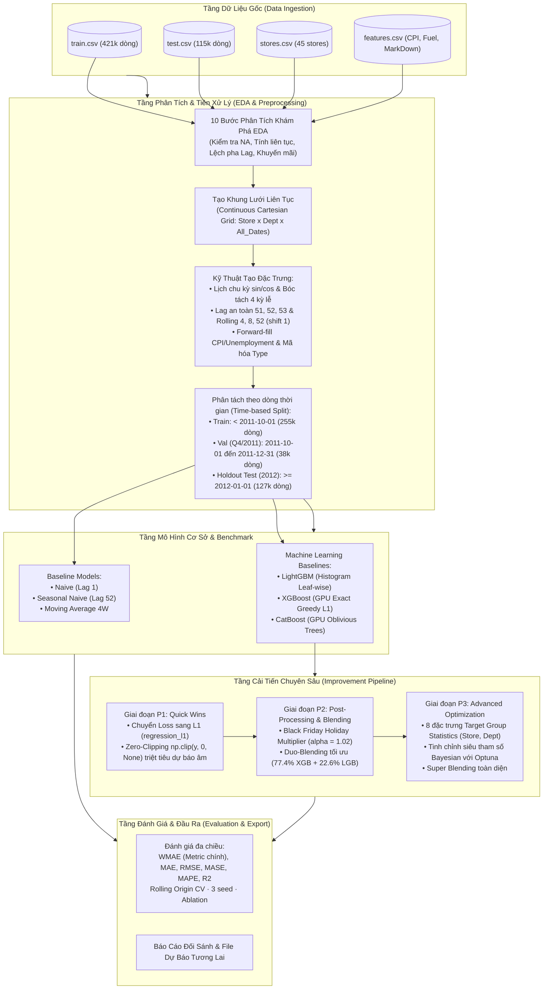
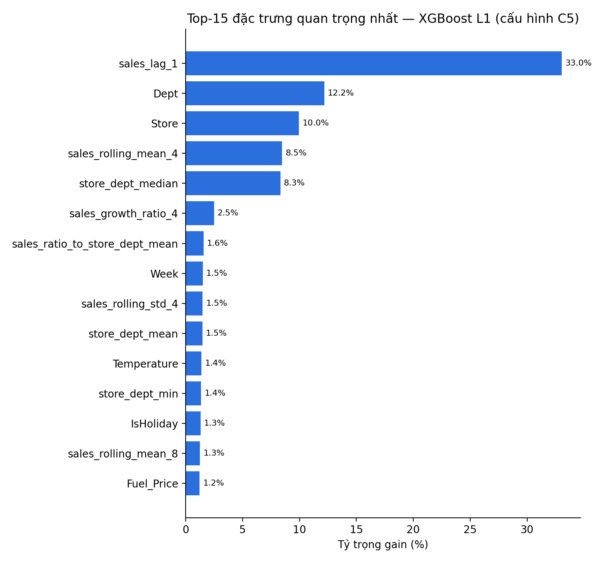

# 📈 BÁO CÁO TỔNG HỢP CUỐI CÙNG (FINAL ANALYZE REPORT)
## DỰ BÁO DOANH SỐ BÁN LẺ WALMART BẰNG HỌC MÁY TRÊN CHUỖI THỜI GIAN
*(Walmart Store Sales Forecasting — Time Series Machine Learning)*

---

## 📑 MỤC LỤC

1. [Giới thiệu & Bản chất bài toán](#1-giới-thiệu--bản-chất-bài-toán)
   - [1.1. Bối cảnh thực tế & Mục tiêu dự báo](#11-bối-cảnh-thực-tế--mục-tiêu-dự-báo)
   - [1.2. Bản chất dữ liệu & Thách thức đặc thù](#12-bản-chất-dữ-liệu--thách-thức-đặc-thù)
2. [Kiến trúc tổng quan (Method Pipeline)](#2-kiến-trúc-tổng-quan-method-pipeline)
   - [2.1. Sơ đồ luồng xử lý toàn diện](#21-sơ-đồ-luồng-xử-lý-toàn-diện)
   - [2.2. Mô tả chức năng từng module trong hệ thống](#22-mô-tả-chức-năng-từng-module-trong-hệ-thống)
3. [Benchmark sử dụng (Baseline Models)](#3-benchmark-sử-dụng-baseline-models)
   - [3.1. Các mô hình cơ sở & Cơ chế toán học](#31-các-mô-hình-cơ-sở--cơ-chế-toán-học)
   - [3.2. Kết quả thực nghiệm của Baseline](#32-kết-quả-thực-nghiệm-của-baseline)
   - [3.3. Phân tích nguyên nhân chênh lệch hiệu năng Baseline](#33-phân-tích-nguyên-nhân-chênh-lệch-hiệu-năng-baseline)
4. [Thang đo đánh giá (Evaluation Metrics)](#4-thang-đo-đánh-giá-evaluation-metrics)
   - [4.1. Độ đo chính: Weighted Mean Absolute Error (WMAE)](#41-độ-đo-chính-weighted-mean-absolute-error-wmae)
   - [4.2. Các độ đo hỗ trợ: MAE, RMSE, MAPE, $R^2$](#42-các-độ-đo-hỗ-trợ-mae-rmse-mape-r2)
   - [4.3. Vai trò và ý nghĩa kinh tế trong quản trị chuỗi cung ứng](#43-vai-trò-và-ý-nghĩa-kinh-tế-trong-quản-trị-chuỗi-cung-ứng)
5. [Các bước thực hiện chính (Main Steps)](#5-các-bước-thực-hiện-chính-main-steps)
   - [5.1. Phân tích khám phá dữ liệu (Chi tiết 10 bước EDA)](#51-phân-tích-khám-phá-dữ-liệu-chi-tiết-10-bước-eda)
   - [5.2. Tiền xử lý dữ liệu & Kỹ thuật đặc trưng (Data Preprocessing)](#52-tiền-xử-lý-dữ-liệu--kỹ-thuật-đặc-trưng-data-preprocessing)
   - [5.3. Các mô hình Machine Learning thực nghiệm](#53-các-mô-hình-machine-learning-thực-nghiệm)
   - [5.4. Chi tiết các bước cải tiến chuyên sâu (P1, P2, P3)](#54-chi-tiết-các-bước-cải-tiến-chuyên-sâu-p1-p2-p3)
6. [Bảng tổng hợp đối sánh & Kết luận](#6-bảng-tổng-hợp-đối-sánh--kết-luận)
   - [6.1. Tiến trình cải tiến (3 seed)](#61-tiến-trình-cải-tiến-3-seed)
   - [6.2. Kết luận & đóng góp kỹ thuật](#62-kết-luận--đóng-góp-kỹ-thuật)
   - [6.3. Hạn chế](#63-hạn-chế)
7. [Đánh giá mở rộng: CV, đa seed, tuning, tuyến tính & ablation](#7-đánh-giá-mở-rộng-cv-đa-seed-tuning-tuyến-tính--ablation)

---

## 1. GIỚI THIỆU & BẢN CHẤT BÀI TOÁN

### 1.1. Bối cảnh thực tế & Mục tiêu dự báo
Trong ngành bán lẻ quy mô lớn (retail enterprise), bài toán tối ưu hóa chuỗi cung ứng, điều phối hàng tồn kho và hoạch định tài chính phụ thuộc sống còn vào độ chính xác của dự báo nhu cầu. Dự án này giải quyết bài toán kinh điển từ tập đoàn bán lẻ **Walmart**:
- **Mục tiêu:** Dự báo doanh số bán hàng hàng tuần (`Weekly_Sales`) cho từng **Phòng ban** (`Dept`) thuộc từng **Cửa hàng** (`Store`) trên toàn nước Mỹ.
- **Quy mô bài toán:**
  - 45 siêu thị/cửa hàng Walmart trải rộng trên các vùng địa lý khác nhau.
  - Tối đa 81 phòng ban/ngành hàng tại mỗi cửa hàng (tổng cộng 3,331 chuỗi thời gian phân cấp độc lập).
  - Chuỗi dữ liệu lịch sử ghi nhận từ ngày **05/02/2010** đến ngày **26/10/2012** (143 tuần huấn luyện), với mục tiêu dự báo 39 tuần tiếp theo cho tập thử nghiệm.

### 1.2. Bản chất dữ liệu & Thách thức đặc thù
Khác với các bài toán chuỗi thời gian đơn biến (univariate) hoặc chuỗi phẳng (flat time series), bài toán dự báo bán lẻ Walmart mang các đặc thù toán học và nghiệp vụ phức tạp:
1. **Phân cấp đa tầng (Hierarchical & Heterogeneous Nature):** Dữ liệu được nhóm theo Cửa hàng $\times$ Phòng ban $\times$ Thời gian. Mỗi phòng ban có hành vi hoàn toàn khác biệt: hàng tạp hóa thiết yếu có cầu ổn định, trong khi phòng ban điện máy, đồ trang sức hay đồ chơi bùng nổ cực hạn vào các dịp lễ hội.
2. **Tính gián đoạn và chuỗi thưa (Intermittent & Missing Intervals):** Có 671 chuỗi thời gian không xuất hiện đầy đủ 143 tuần do mở mới, ngừng kinh doanh tạm thời hoặc hàng tồn kho bằng 0. Nếu tính hàm trễ (Lag) trên chuỗi rời rạc sẽ gây ra hiện tượng trôi dạt chỉ mục (Index Shift).
3. **Hiện tượng lệch pha lịch ngày lễ (Holiday Calendar Shift):** 4 ngày lễ trọng điểm của Mỹ gồm *Super Bowl*, *Labor Day*, *Thanksgiving*, và *Christmas*. Lễ Tạ Ơn (Thanksgiving) rơi vào thứ Năm thứ tư của tháng 11, dẫn đến việc tuần báo cáo ISO bị dao động giữa tuần 47 và tuần 48. Đỉnh Giáng Sinh thực chất diễn ra ở tuần 51 (ngay trước Giáng Sinh tuần 52).
4. **Hàm phạt bất đối xứng WMAE ($\times 5$ trọng số ngày lễ):** Sai số trong 4 tuần lễ bị phạt nặng gấp 5 lần so với tuần thông thường, đòi hỏi thuật toán phải nắm bắt chuẩn xác biên độ của các đỉnh doanh số.
5. **Dự báo đa bước tương lai (Multi-step Horizon):** Tập kiểm thử trải dài 39 tuần liên tiếp mà không có nhãn thực tế giữa chừng, tạo nguy cơ rò rỉ thông tin (Lookahead Data Leakage) nếu sử dụng các độ trễ ngắn hạn (như Lag 1 đến Lag 4) mà không có cơ chế hồi quy tự đệ quy (recursive forecasting).

---

## 2. KIẾN TRÚC TỔNG QUAN (METHOD PIPELINE)

Hệ thống được thiết kế theo cấu trúc module hóa phân tầng, chống rò rỉ dữ liệu nghiêm ngặt theo trục thời gian, đảm bảo tính tái lập (reproducibility) và sẵn sàng triển khai thực tế.

### 2.1. Sơ đồ luồng xử lý toàn diện



### 2.2. Mô tả chức năng từng module trong hệ thống

Mã nguồn (`Src/`, `Data/`, `Metric/`), trọng số mô hình (`checkpoints/`) và kết quả (`results/`, đánh số theo giai đoạn) được tách riêng; mọi đường dẫn khai báo tập trung trong `Config/config.toml`.

| Module | Chức năng | Kết quả |
| :--- | :--- | :--- |
| `Data/Origin/` | Tải 4 file dữ liệu gốc từ Kaggle (`download_data.py`) | `Data/Origin/data/` |
| `Data/EDA/eda.py` | 10 bước phân tích khám phá, định hình chiến lược tiền xử lý | `results/00_eda/` |
| `Data/Preprocess/preprocess.py` | Lưới tuần liên tục, lag, rolling, lịch, nội suy biến ngoại sinh | `Data/Preprocess/data/*.parquet` |
| `Src/Baseline/` | Naive, Seasonal Naive, Moving Average; Ridge/Lasso (`linear_baseline.py`) | `results/01_baseline/` |
| `Src/LightGBM/`, `Src/XGBoost/`, `Src/CatBoost/` | Huấn luyện / đánh giá 3 GBDT trên 44 đặc trưng | `checkpoints/<model>/`, `results/02_gbdt/` |
| `Src/Experiments/` | Tuning đồng nhất, đa seed, ablation (đánh giá mô hình gốc); tái lập Hướng 1 × 3 seed | `results/03_tuning`, `05_multiseed`, `06_ablation`, `07_improvement/a_p1_p3` |
| `Src/Evaluation/` | Rolling Origin CV; sinh bảng đối sánh Markdown + LaTeX | `results/04_time_series_cv`, `08_benchmark_tables` |
| `Src/Improvement/P1..P3` | P1: L1 + Zero-Clipping · P2: Holiday Multiplier + Blending · P3: Group Stats + Optuna + Super Blend | `checkpoints/p1_*`, `p3_*`, `results/07_improvement/a_p1_p3/` |
| `Src/Utils/system_profiler.py` | Ghi phần cứng, đo thời gian, đếm số tham số mô hình | `results/hardware_info.json` |

Thư mục `results/` được đánh số theo đúng thứ tự phụ thuộc của pipeline: **00–02** dữ liệu & mô hình gốc → **03–06** đánh giá / phân tích mô hình gốc (tuning → CV, multi-seed; ablation) → **07** ba hướng cải tiến (a → b → c) → **08** bảng tổng hợp cho báo cáo.

---

## 3. BENCHMARK SỬ DỤNG (BASELINE MODELS)

Để xác minh giá trị thực chất của các thuật toán học máy, dự án thiết lập 3 mô hình chuẩn mực (Benchmark) kinh điển trong phân tích chuỗi thời gian:

### 3.1. Các mô hình cơ sở & Cơ chế toán học

1. **Naive Model (Dự báo quán tính 1 bước):**
   - Giả định rằng doanh số tuần hiện tại bằng đúng doanh số tuần liền trước:
     $$\hat{y}_t = y_{t-1}$$
   - *Đặc điểm:* Rất nhạy với biến động ngắn hạn nhưng hoàn toàn bỏ qua tính mùa vụ hàng năm.
2. **Seasonal Naive Model (Dự báo mùa vụ cùng kỳ năm trước):**
   - Giả định doanh số tuần hiện tại lặp lại chính xác doanh số của tuần này 1 năm trước (52 tuần trước):
     $$\hat{y}_t = y_{t-52}$$
   - *Đặc điểm:* Nắm bắt được chu kỳ năm nhưng cực kỳ dễ tổn thương khi ngày lễ bị dịch chuyển tuần (Holiday Calendar Shift).
3. **Moving Average 4 Weeks (Trung bình trượt 4 tuần gần nhất):**
   - Dự báo bằng giá trị trung bình cộng của 4 tuần vừa qua:
     $$\hat{y}_t = \frac{1}{4} \sum_{i=1}^4 y_{t-i}$$
   - *Đặc điểm:* Làm mượt các nhiễu ngẫu nhiên ngắn hạn, ổn định hơn Naive đơn lẻ.

### 3.2. Kết quả thực nghiệm của Baseline

**(a) Trên Validation Q4/2011 và Holdout Test 2012** — cùng giao thức với các mô hình học máy (trích Bảng 1, mục 7):

| Mô hình Baseline | Val WMAE (Q4/2011) ↓ | Test WMAE (2012) ↓ | Test MAE ↓ | Test RMSE ↓ | Test MASE ↓ |
| :--- | :---: | :---: | :---: | :---: | :---: |
| **Seasonal Naive ($y_{t-52}$)** | **2,294.98** | **1,775.43** | **1,768.31** | **3,784.16** | **0.899** |
| **Moving Average (4W)** | 4,424.14 | 2,006.54 | 1,941.02 | 4,847.24 | 0.987 |

**(b) Trên toàn bộ dữ liệu 2010–2012** (`results/01_baseline/baseline_results.txt`, gồm cả năm đầu chưa đủ lịch sử):

| Mô hình Baseline | WMAE (USD) ↓ | MAE (USD) ↓ | RMSE (USD) ↓ | MAPE (%) ↓ | $R^2$ ↑ |
| :--- | :---: | :---: | :---: | :---: | :---: |
| **Moving Average (4W)** | **2,626.55** | **2,155.02** | **6,518.65** | 560.07% | **0.9177** |
| **Naive ($y_{t-1}$)** | 2,863.39 | 2,203.65 | 7,611.64 | **86.13%** | 0.8877 |
| **Seasonal Naive ($y_{t-52}$)** | 7,236.81 | 7,022.23 | 17,147.09 | 154.77% | 0.4300 |

### 3.3. Phân tích nguyên nhân chênh lệch hiệu năng Baseline
- **Phạm vi đánh giá quyết định thứ hạng:** Trên toàn bộ dữ liệu (b), Seasonal Naive có vẻ "sụp đổ" (WMAE 7,236.81) — nhưng nguyên nhân chính là **52 tuần đầu tiên (02/2010 – 01/2011) chưa có `sales_lag_52`**: preprocess điền giá trị giữ chỗ −1, tức mô hình dự báo ≈ 0 cho cả năm 2010. Đây là tác dụng phụ của cách đánh giá, không phải điểm yếu của phương pháp.
- **Trên tập đánh giá chuẩn (a), Seasonal Naive là baseline mạnh nhất:** WMAE Test 1,775.43 so với 2,006.54 của Moving Average, và tốt hơn hẳn trên Val Q4 (2,294.98 so với 4,424.14) — vì chu kỳ năm 52 tuần chi phối doanh số lễ hội, trong khi trung bình 4 tuần luôn "trễ pha" ở các đỉnh Thanksgiving / Giáng Sinh.
- **Holiday Calendar Shift vẫn có tác động:** Thanksgiving rơi vào tuần 47 (2010, 2012) nhưng tuần 48 (2011), nên $y_{t-52}$ lệch đúng một tuần ở các đỉnh lễ — lý do bộ ba `sales_lag_51/52/53` và `weeks_to_thanksgiving` được đưa vào mô hình học máy.
- Vì vậy mọi so sánh với baseline trong báo cáo dùng **Seasonal Naive trên tập (a)** làm mốc chuẩn; mẫu số của MASE cũng chính là sai số Seasonal Naive trong mẫu.

---

## 4. THANG ĐO ĐÁNH GIÁ (EVALUATION METRICS)

### 4.1. Độ đo chính: Weighted Mean Absolute Error (WMAE)
Đây là thang đo tiêu chuẩn chính thức của cuộc thi Walmart Sales Forecasting trên Kaggle. WMAE được định nghĩa như sau:

$$\text{WMAE} = \frac{\sum_{i=1}^n w_i |y_i - \hat{y}_i|}{\sum_{i=1}^n w_i}$$

Trong đó:
- $n$ là tổng số lượng mẫu dự báo.
- $y_i$ là doanh số thực tế tuần thứ $i$, $\hat{y}_i$ là doanh số do mô hình dự báo.
- $w_i$ là trọng số đánh giá:
  $$w_i = \begin{cases} 5, & \text{nếu tuần } i \text{ rơi vào một trong bốn kỳ nghỉ lễ lớn} \\ 1, & \text{nếu là tuần thông thường} \end{cases}$$

### 4.2. Các độ đo hỗ trợ: MAE, RMSE, MAPE, $R^2$, MASE
Để đánh giá toàn diện hành vi mô hình từ nhiều góc độ toán học:
1. **Mean Absolute Error (MAE):**
   $$\text{MAE} = \frac{1}{n} \sum_{i=1}^n |y_i - \hat{y}_i|$$
   Đo lường sai số tuyệt đối trung bình không phân biệt ngày lễ, phản ánh trực tiếp sai số USD trung bình trên mỗi phòng ban.
2. **Root Mean Squared Error (RMSE):**
   $$\text{RMSE} = \sqrt{\frac{1}{n} \sum_{i=1}^n (y_i - \hat{y}_i)^2}$$
   Phạt rất nặng các điểm sai số ngoại lệ lớn (outliers) do bình phương sai số, phản ánh mức độ ổn định của dự báo ở các quầy hàng doanh số hàng trăm nghìn USD.
3. **Mean Absolute Percentage Error (MAPE):**
   $$\text{MAPE} = \frac{100\%}{n} \sum_{i=1}^n \left| \frac{y_i - \hat{y}_i}{y_i} \right|$$
   Đo sai số tương đối theo tỷ lệ phần trăm. Độ đo này cực kỳ nhạy cảm và dễ bùng nổ khi doanh số thực tế $y_i$ tiệm cận 0 USD.
4. **Hệ số xác định ($R^2$ Score):**
   $$R^2 = 1 - \frac{\sum_{i=1}^n (y_i - \hat{y}_i)^2}{\sum_{i=1}^n (y_i - \bar{y})^2}$$
   Phản ánh tỷ lệ phần trăm phương sai của doanh số bán lẻ được mô hình giải thích được (càng gần 1.0 càng hoàn hảo).
5. **Mean Absolute Scaled Error (MASE):**
   $$\text{MASE} = \frac{\frac{1}{h}\sum_{t=1}^{h}|y_t-\hat{y}_t|}{\frac{1}{N-m}\sum_{t=m+1}^{N}|y_t-y_{t-m}|}, \quad m = 52$$
   Chuẩn hóa MAE theo sai số Seasonal Naive trong mẫu (chi tiết ở mục 7.1). MASE < 1 nghĩa là tốt hơn việc lặp lại doanh số cùng kỳ năm trước; không phụ thuộc đơn vị và không bùng nổ khi $y \approx 0$ như MAPE.

### 4.3. Vai trò và ý nghĩa kinh tế trong quản trị chuỗi cung ứng
- **WMAE (Trọng số 5x ngày lễ):** Trong bán lẻ, tuần lễ hội (Thanksgiving/Black Friday, Giáng Sinh) đóng góp từ 30% đến 50% lợi nhuận cả năm. Thiếu hàng (Stock-out) vào ngày lễ gây thiệt hại doanh thu và mất khách hàng vĩnh viễn; thừa hàng gây ứ đọng vốn và chi phí thanh lý. Trọng số 5x mô phỏng chính xác thiệt hại kinh tế này.
- **RMSE (Kiểm soát rủi ro phòng ban lớn):** Đảm bảo mô hình không phạm sai số nghiêm trọng ở các phòng ban chủ lực tạo doanh thu cao (Dept 72, Dept 92).
- **Zero-Clipping & MAPE (Tính hợp lý trong kinh doanh):** Dự báo doanh số âm trong bán lẻ là vô nghĩa và làm sai lệch báo cáo dòng tiền của hệ thống ERP.

---

## 5. CÁC BƯỚC THỰC HIỆN CHÍNH (MAIN STEPS)

### 5.1. Phân tích khám phá dữ liệu (Chi tiết 10 bước EDA)

Toàn bộ quá trình phân tích khám phá dữ liệu được thiết kế và triển khai có hệ thống trong module [Data/EDA/eda.py](Data/EDA/eda.py) gồm 10 bước độc lập (15 biểu đồ lưu tại `results/00_eda/`):

```
[EDA Workflow: 10 Bước Phân Tích Chuyên Sâu]
 ├── Bước 0: Kiểm tra giá trị khuyết (Missing Values Across Tables)
 ├── Bước 1: Tính toàn vẹn thời gian & Lưới Cartesian Product
 ├── Bước 2: Phân phối Weekly_Sales, Negative Sales & Retransformation Bias
 ├── Bước 3: Phân rã chuỗi thời gian (Trend, Seasonality, Residuals)
 ├── Bước 4: Tác động ngày lễ, Holiday Shift & Lệch pha Lag-52
 ├── Bước 5: Phân cấp cửa hàng & phòng ban (Store & Dept Hierarchy)
 ├── Bước 6: Khảo sát đặc tính cửa hàng (Type A/B/C & Size)
 ├── Bước 7: Phân tích các đợt khuyến mãi MarkDown 1 -> 5
 ├── Bước 8: Yếu tố kinh tế vĩ mô & Thời tiết (CPI, Fuel, Unemployment)
 ├── Bước 9: Phân tích tự tương quan (ACF) & Rủi ro 39-week Test Horizon
 └── Bước 10: Kiểm tra dịch chuyển phân phối Train vs Test (Covariate Shift)
```

#### Bước 0: Kiểm tra giá trị khuyết trên toàn bộ các bảng dữ liệu
- **Cách thực hiện:** Quét toàn bộ các cột trong 4 bảng (`train`, `test`, `stores`, `features`), thống kê số lượng `null` và tỷ lệ phần trăm tương ứng.
- **Công dụng:** Xác định các thuộc tính bị thiếu hụt để lên phương án điền khuyết (imputation) thích hợp, tránh lỗi tính toán cho các mô hình không hỗ trợ NA.
- **Kết quả phân tích:**
  - `train.csv`, `stores.csv`: Dữ liệu hoàn chỉnh 100%, không khuyết dòng nào.
  - `features.csv`: Khuyết cực nặng tại các cột khuyến mãi `MarkDown1` đến `MarkDown5` (từ 59.99% đến 73.08% giá trị NaN). Ngoài ra, `CPI` và `Unemployment` bị khuyết ở các tuần cuối của tập Test (585 dòng, ~7.14%).

#### Bước 1: Tính toàn vẹn thời gian & Phân tích rủi ro tái lập chỉ mục (Cartesian Product)
- **Cách thực hiện:** Lập tích Descartes đầy đủ giữa 3,331 cặp `(Store, Dept)` duy nhất với toàn bộ 143 tuần quan sát của tập Train ($3,331 \times 143 = 476,333$ ô lưới lý thuyết), sau đó đối chiếu với 421,570 dòng thực tế có trong `train.csv`.
- **Công dụng:** Phát hiện sự đứt gãy trong chuỗi thời gian để bảo toàn tính chuẩn xác cho các phép toán dịch chuyển độ trễ `shift()`.
- **Kết quả phân tích:**
  - Có tới **671 chuỗi thời gian (20.14%)** bị gián đoạn, bắt đầu muộn hoặc kết thúc sớm (thiếu hụt 54,763 dòng ghi nhận).
  - *Rủi ro nghiêm trọng:* Nếu không tái lập lưới liên tục, phép gọi `shift(1)` trên chuỗi thô sẽ vô tình lấy dữ liệu của 2 hoặc 3 tuần trước đó thay vì tuần liền trước, làm sai lệch pha thời gian toàn bộ các đặc trưng Lag và Rolling.
  - *Quyết định kỹ thuật:* Xây dựng lưới thời gian liên tục (`build_continuous_time_grid`) và điền $0.0$ cho các tuần đứt gãy.

#### Bước 2: Khảo sát phân phối biến mục tiêu, Doanh số âm & Thiên lệch biến đổi ngược
- **Cách thực hiện:** Thống kê giá trị nhỏ nhất, lớn nhất, số lượng bản ghi có $y < 0$ và $y = 0$; so sánh phân phối gốc với phân phối sau khi cắt giới hạn (`np.clip(y, 0, None)`).
- **Công dụng:** Kiểm tra tính khả thi của các phép biến đổi logarit và định hình hàm mất mát tối ưu.
- **Kết quả phân tích:**
  - Có **1,285 bản ghi (0.30%)** có doanh số âm (thấp nhất là -4,988.94 USD do khách trả hàng hoặc điều chỉnh kiểm kê).
  - Có 73 bản ghi có doanh số bằng 0.
  - *Nguy cơ toán học:* Biến đổi $\log(1+y)$ sẽ bị lỗi `NaN/ValueError` do giá trị âm $\le -1$. Đồng thời, việc huấn luyện trên thang log sau đó biến đổi ngược $\exp(\hat{y})-1$ sẽ gây thiên lệch toán học (Retransformation Bias: $\mathbb{E}[y] \neq \exp(\mathbb{E}[\log y])$), tối ưu hóa sai lệch khỏi mục tiêu L1 của thang đo WMAE.
  - *Quyết định kỹ thuật:* Giữ nguyên thang đo thực tế USD và sử dụng hàm mất mát chuẩn L1/MAE.

#### Bước 3: Phân rã chuỗi thời gian: Xu hướng (Trend) & Mùa vụ (Seasonality)
- **Cách thực hiện:** Tổng hợp tổng doanh số toàn hệ thống theo từng tuần, áp dụng phương pháp phân rã cộng tính (`seasonal_decompose(period=52)`).
- **Công dụng:** Tách biệt xu hướng tăng trưởng dài hạn, chu kỳ lặp lại hàng năm và các biến động bất thường (Residuals).
- **Kết quả phân tích:**
  - Chu kỳ mùa vụ thể hiện chu kỳ lặp lại 52 tuần cực kỳ rõ nét.
  - Doanh số duy trì ổn định trong các quý 1, 2, 3 nhưng tăng vọt gấp 1.8 đến 2.2 lần vào quý 4 (tháng 11 và 12). Xu hướng dài hạn (trend) có độ dốc tăng nhẹ qua các năm 2010 - 2012.

#### Bước 4: Tác động ngày lễ, Dịch chuyển lịch & Lệch pha Lag-52
- **Cách thực hiện:** Lập ma trận đối chiếu số tuần ISO của 4 kỳ nghỉ lễ lớn xuyên suốt từ năm 2010 đến 2013; phân tích doanh số trung bình theo từng loại ngày lễ.
- **Công dụng:** Kiểm tra tính đồng bộ của đặc trưng `sales_lag_52` đối với các đỉnh mua sắm.
- **Kết quả phân tích:**
  - Lễ Tạ Ơn (Thanksgiving) năm 2010 rơi vào tuần 47, năm 2011 rơi vào tuần 48, nhưng năm 2012 lại quay lại tuần 47.
  - Đỉnh mua sắm Giáng Sinh diễn ra mạnh nhất ở **tuần 51** (tuần trước Giáng Sinh), với doanh số cao gần gấp đôi chính tuần Giáng Sinh 52.
  - *Hậu quả:* Một đặc trưng `sales_lag_52` cố định sẽ bị lệch đúng 1 tuần vào dịp Black Friday giữa năm 2011 và 2012.
  - *Quyết định kỹ thuật:* Bổ sung đồng thời bộ 3 đặc trưng trễ `sales_lag_51`, `sales_lag_52`, `sales_lag_53` và biến khoảng cách tuần đến Thanksgiving `weeks_to_thanksgiving`.

#### Bước 5: Phân cấp cửa hàng và phòng ban theo tỷ trọng doanh số
- **Cách thực hiện:** Tính tổng doanh thu tích lũy của từng phòng ban và cửa hàng, vẽ biểu đồ phân phối Pareto.
- **Công dụng:** Xác định các phòng ban và cửa hàng đầu tàu chi phối phần lớn sai số WMAE và RMSE của hệ thống.
- **Kết quả phân tích:**
  - Quy luật Pareto 80/20 thể hiện rõ: Top 10 phòng ban (Dept 92, 95, 38, 72, 90, 40, 2, 91, 94, 8) đóng góp hơn 52% tổng doanh thu của toàn bộ 45 siêu thị.
  - Cửa hàng có doanh thu trung bình tuần cao nhất đạt trên 45,000 USD/tuần, trong khi cửa hàng nhỏ nhất chỉ đạt dưới 6,000 USD/tuần (chênh lệch gấp gần 8 lần).

#### Bước 6: Khảo sát đặc tính cửa hàng (Type A/B/C và Diện tích mặt sàn)
- **Cách thực hiện:** Hợp nhất `stores.csv` với bảng doanh số, phân tích mối tương quan giữa diện tích (`Size`), phân loại (`Type`) với mức doanh thu hàng tuần.
- **Công dụng:** Đánh giá giá trị thông tin của các đặc trưng tĩnh mô tả cửa hàng.
- **Kết quả phân tích:**
  - Cửa hàng **Type A** (22 cửa hàng): Diện tích trung bình 177,248 sqft, doanh số trung bình 20,099 USD/tuần.
  - Cửa hàng **Type B** (17 cửa hàng): Diện tích trung bình 101,191 sqft, doanh số trung bình 12,237 USD/tuần.
  - Cửa hàng **Type C** (6 cửa hàng): Diện tích trung bình 40,520 sqft, doanh số trung bình 9,519 USD/tuần.
  - Diện tích mặt sàn có tương quan thuận rõ rệt ($r \approx 0.24$) với doanh số bán lẻ.

#### Bước 7: Đánh giá dữ liệu khuyến mãi (MarkDown 1 đến MarkDown 5)
- **Cách thực hiện:** Phân tích tỷ lệ xuất hiện của các cột MarkDown theo trục thời gian từ 2010 đến 2012.
- **Công dụng:** Làm rõ tính liên tục và độ tin cậy của các chiến dịch giảm giá.
- **Kết quả phân tích:**
  - Dữ liệu MarkDown hoàn toàn không được ghi nhận trước tháng 11/2011 (tỷ lệ khuyết 100% trong toàn bộ giai đoạn 2010 - 10/2011).
  - Walmart chỉ bắt đầu theo dõi chi tiết các chương trình khuyến mãi từ tháng 11/2011 trở đi.
  - *Ý nghĩa:* Dữ liệu MarkDown chịu hiện tượng dịch chuyển phân phối theo thời gian (Distributional Shift). Không thể dùng các mô hình phụ thuộc quá nhiều vào MarkDown để suy luận cho quá khứ, nhưng trong tương lai (tập Test 2012) thì MarkDown lại xuất hiện khá đầy đủ.

#### Bước 8: Tương quan kinh tế vĩ mô và thời tiết
- **Cách thực hiện:** Tính ma trận tương quan Pearson giữa `Weekly_Sales` với `Temperature`, `Fuel_Price`, `CPI`, `Unemployment`.
- **Công dụng:** Đánh giá mức độ ảnh hưởng của các yếu tố ngoại sinh đến doanh thu bán lẻ.
- **Kết quả phân tích:**
  - Hệ số tương quan trực tiếp giữa doanh số tuần với các biến vĩ mô tương đối thấp ($|r| < 0.07$).
  - `Fuel_Price` có xu hướng tăng mạnh từ năm 2010 đến 2012, trong khi `CPI` tăng đều và `Unemployment` giảm dần. Các biến này phản ánh xu hướng vĩ mô dài hạn chứ không tạo ra các cú sốc doanh số ngắn hạn như yếu tố ngày lễ.

#### Bước 9: Phân tích hàm tự tương quan (ACF) & Rủi ro độ trễ Test Horizon 39 tuần
- **Cách thực hiện:** Tính hệ số tự tương quan (Autocorrelation) trên toàn chuỗi thời gian ở các mức trễ từ 1 đến 55 tuần, đánh giá khả năng sử dụng trong thực tế.
- **Công dụng:** Ngăn chặn tuyệt đối hiện tượng rò rỉ dữ liệu (Data Leakage) khi xây dựng các biến trễ (Lag features).
- **Kết quả phân tích:**
  - `Lag 1` có tương quan cao nhất ($r = 0.28$ ở cấp độ vi mô, lên tới $0.85$ ở cấp độ vĩ mô), theo sau là `Lag 52` ($r = 0.926$ trên tổng doanh số chuỗi).
  - *Cảnh báo rò rỉ thông tin:* Tập kiểm thử (Test) kéo dài 39 tuần liên tiếp không có nhãn. Do đó, các biến trễ ngắn như `Lag 1`, `Lag 2`, `Lag 4` chỉ có thể dùng cho mô hình dự báo 1 bước hoặc phải áp dụng kỹ thuật dự báo cuốn chiếu tự đệ quy (recursive forecasting).
  - Để đảm bảo tính an toàn tuyệt đối khi triển khai dự báo đồng loạt (Direct Forecasting) cho toàn bộ 39 tuần, các biến trễ mùa vụ $\ge 39$ tuần (như `Lag 51`, `Lag 52`, `Lag 53`) là những biến an toàn tuyệt đối và có độ tin cậy cực cao.

#### Bước 10: Kiểm tra tính nhất quán phân phối Train vs Test (Covariate Shift)
- **Cách thực hiện:** Sử dụng biểu đồ hàm mật độ xác suất nhân (KDE) so sánh phân phối của các biến đầu vào giữa tập Huấn luyện (Train $\le$ 10/2012) và tập Kiểm thử (Test > 10/2012).
- **Công dụng:** Đánh giá nguy cơ mô hình bị suy giảm hiệu năng do dữ liệu tương lai thay đổi phân phối.
- **Kết quả phân tích:**
  - Nhiệt độ (`Temperature`) giữ nguyên tính mùa vụ hoàn hảo giữa hai tập.
  - `CPI` và `Fuel_Price` ở tập Test có mức trung bình cao hơn tập Train (CPI tăng từ 171.2 lên 176.9), phản ánh đúng thực tế lạm phát và đà tăng giá năng lượng tại Mỹ năm 2012.

---

### 5.2. Tiền xử lý dữ liệu & Kỹ thuật đặc trưng (Data Preprocessing)

Toàn bộ phát hiện từ 10 bước EDA được chuyển hóa thành các giải pháp kỹ thuật cụ thể trong module [Data/Preprocess/preprocess.py](Data/Preprocess/preprocess.py):

#### 1. Xây dựng khung lưới thời gian liên tục (Continuous Cartesian Grid)
- **Lý do:** Khắc phục 20.14% chuỗi bị đứt gãy phát hiện ở Bước 1 EDA, đảm bảo mọi phép toán trễ theo tuần đều rơi đúng vào khoảng cách thời gian 7 ngày.
- **Cách thực hiện:** Tạo tích Descartes giữa 3,331 cặp `(Store, Dept)` với 182 tuần liên tục (từ 05/02/2010 đến 26/07/2013). Các tuần bị gián đoạn giữa chừng trong giai đoạn Train được điền `Weekly_Sales = 0.0`.
- **Kết quả:** Chuẩn hóa hoàn hảo cấu trúc chuỗi thời gian, loại bỏ hoàn toàn lỗi trôi dạt chỉ mục (Index Shift).

#### 2. Xử lý giá trị khuyết và mã hóa thuộc tính (Imputation & Encoding)
- **Cột MarkDown:** Điền $0.0$ cho tất cả các giá trị NaN. Tạo thêm 2 đặc trưng tổng hợp:
  - `Total_MarkDown = MarkDown1 + MarkDown2 + MarkDown3 + MarkDown4 + MarkDown5`
  - `Has_MarkDown = (Total_MarkDown > 0).astype(int)`
- **Cột CPI & Unemployment:** Nội suy theo từng Store bằng phương pháp truyền giá trị về trước kết hợp về sau (`groupby('Store').ffill().bfill()`).
- **Mã hóa Type:** Ánh xạ thứ tự (`{'A': 1, 'B': 2, 'C': 3}`).
- **Mã hóa IsHoliday:** Chuyển boolean thành nhị phân nguyên (`0` hoặc `1`).

#### 3. Bóc tách lịch tuần hoàn & Giải quyết lệch pha ngày lễ (Calendar & Holiday Shift Alignment)
- **Biến đổi chu kỳ Sin/Cos:** Trích xuất biến đổi lượng giác cho tuần trong năm (`Week`) và tháng (`Month`):
  $$\text{Week\_sin} = \sin\left(\frac{2\pi \cdot \text{Week}}{52}\right), \quad \text{Week\_cos} = \cos\left(\frac{2\pi \cdot \text{Week}}{52}\right)$$
  Giúp mô hình hiểu rằng tuần 52 và tuần 1 nằm sát cạnh nhau trên vòng tròn thời gian.
- **Bóc tách 4 kỳ nghỉ lễ riêng biệt:**
  - `is_super_bowl`: Tuần 5 hoặc 6 có cờ `IsHoliday`.
  - `is_labor_day`: Tuần 36 có cờ `IsHoliday`.
  - `is_thanksgiving`: Tuần 47 hoặc 48 có cờ `IsHoliday`.
  - `is_christmas`: Tuần 51 hoặc 52 có cờ `IsHoliday`.
  - `is_pre_christmas_peak`: Cờ riêng cho tuần 51 (tuần bùng nổ doanh số cao nhất năm).
  - `weeks_to_thanksgiving`: Khoảng cách tuần tương đối $|\text{Week} - 47|$ để mô hình nắm bắt sớm đà tăng trưởng trước Black Friday.

#### 4. Kỹ thuật tạo biến trễ (Lag) và biến thống kê trượt (Rolling Window Statistics)
- **Quy tắc sống còn chống rò rỉ dữ liệu (Lookahead Bias):** Toàn bộ dữ liệu được sắp xếp nghiêm ngặt theo `['Store', 'Dept', 'Date']`. Mọi biến trượt đều phải áp dụng `shift(1)` trước khi tính toán để đảm bảo thông tin của chính tuần dự đoán không bị lộ vào tập đặc trưng:
  ```python
  shifted_sales = df.groupby(['Store', 'Dept'])['Weekly_Sales'].shift(1)
  ```
- **Bộ 3 biến trễ an toàn cho tương lai (Safe Multi-step Lags):** `sales_lag_51`, `sales_lag_52`, `sales_lag_53` (tương quan 0.926, an toàn tuyệt đối cho tập Test 39 tuần).
- **Bộ biến trễ ngắn hạn:** `sales_lag_1`, `sales_lag_2`, `sales_lag_4`, `sales_lag_8`.
- **Thống kê cửa sổ trượt:**
  - `sales_rolling_mean_4`, `sales_rolling_std_4`: Trung bình và độ lệch chuẩn 1 tháng gần nhất.
  - `sales_rolling_mean_8`: Trung bình 2 tháng gần nhất.
  - `sales_rolling_mean_52`: Trung bình trượt cả năm.
  - `sales_growth_ratio_4`: Tỷ số tăng trưởng ngắn hạn $\frac{\text{sales\_lag\_1}}{\text{sales\_rolling\_mean\_4} + 1.0}$.
  - `sales_to_size_ratio`: Tỷ số doanh thu trên diện tích sàn $\frac{\text{sales\_rolling\_mean\_4}}{\text{Size} + 1.0}$.

#### 5. Phân tách tập dữ liệu theo dòng thời gian (Time-based Data Splitting)
Tuyệt đối không sử dụng phép chia ngẫu nhiên (Random K-Fold) nhằm chống rò rỉ tương lai vào quá khứ. Toàn bộ tập dữ liệu được phân chia thành 3 phần rõ rệt:
- **Tập Train (trước 01/10/2011):** 255,364 dòng.
- **Tập Validation (01/10/2011 – 31/12/2011 - Q4/2011):** 38,768 dòng (chứa toàn bộ cao điểm lễ hội cuối năm với trọng số phạt $\times 5$).
- **Tập Holdout Test (từ 01/01/2012 trở đi - Năm 2012):** 127,438 dòng (giai đoạn tương lai ngoài mẫu).
- **Không gian đặc trưng hoàn chỉnh:** 44 cột đặc trưng đầu vào, lưu trữ dưới định dạng Parquet tốc độ cao.

---

### 5.3. Các mô hình Machine Learning thực nghiệm

Ba thuật toán hàng đầu trong học máy có giám sát dạng bảng (Tabular Gradient Boosted Decision Trees) đã được cài đặt và huấn luyện:

#### 1. LightGBM (Light Gradient Boosting Machine)
- **Cơ chế hoạt động:**
  - Sử dụng thuật toán Histogram-based để gom nhóm các giá trị số liên tục thành 255 bins rời rạc, giúp giảm thiểu chi phí tính toán điểm cắt nhánh.
  - Áp dụng kỹ thuật phát triển cây theo chiều sâu tối ưu hóa lá (**Leaf-wise tree growth**) thay vì theo từng tầng (Level-wise), cho phép cây hội tụ nhanh và tối thiểu hóa sai số hàm mất mát tốt hơn với cùng số lượng lá.
- **Lý do chọn:** Tốc độ huấn luyện vượt trội, tiêu tốn ít bộ nhớ RAM, xử lý rất tốt các ma trận thưa và dữ liệu chuỗi thời gian lớn.
- **Cấu hình ban đầu** (`Src/LightGBM/train.py`): `objective='regression'` (L2 Loss / MSE), `learning_rate=0.03`, `num_leaves=31`, `n_estimators=5000` với early stopping 100 vòng trên Val, đa luồng CPU (OpenMP).

#### 2. XGBoost (Extreme Gradient Boosting)
- **Cơ chế hoạt động:**
  - Xây dựng cây tăng cường dựa trên xấp xỉ chuỗi Taylor bậc 2 của hàm mất mát (cả Gradient $g_i$ bậc 1 và Hessian $h_i$ bậc 2).
  - Tích hợp số hạng điều chuẩn hóa chặt chẽ (Regularization L1 $\alpha$ và L2 $\lambda$) trực tiếp vào hàm mục tiêu để kiểm soát độ phức tạp của cây.
- **Lý do chọn:** Khả năng kiểm soát hiện tượng quá khớp (overfitting) cực kỳ chặt chẽ; hỗ trợ tăng tốc GPU thuần (CUDA) cho phép huấn luyện siêu nhanh trên card đồ họa NVIDIA RTX 3050.
- **Cấu hình ban đầu** (`Src/XGBoost/train.py`): `objective='reg:absoluteerror'` (L1 Loss), `tree_method='hist'`, `device='cuda'`, `learning_rate=0.05`, `max_depth=8`, `subsample=colsample_bytree=0.8`, `n_estimators=2000` với early stopping 50 vòng.

#### 3. CatBoost (Categorical Boosting)
- **Cơ chế hoạt động:**
  - Sử dụng kiến trúc cây đối xứng đồng dạng (**Symmetric / Oblivious Trees**): trong cùng một tầng, tất cả các nút đều dùng chung một điều kiện phân nhánh, giúp ngăn chặn hiện tượng quá khớp và cho tốc độ dự báo (inference) cực nhanh.
  - Ứng dụng kỹ thuật **Ordered Boosting** để loại bỏ hiện tượng rò rỉ mục tiêu khi mã hóa các biến phân loại.
- **Lý do chọn:** Hiệu năng rất cao trên các bài toán có nhiều biến danh mục phân cấp như `Store` và `Dept`, chạy trực tiếp trên GPU.
- **Cấu hình ban đầu** (`Src/CatBoost/train.py`): `loss_function='RMSE'` + trọng số mẫu WMAE, `eval_metric='MAE'`, `task_type='GPU'`, `iterations=1500`, `depth=8`, `learning_rate=0.08`, early stopping 50 vòng.

---

#### Kết quả thực nghiệm của 3 mô hình học máy cơ sở

*Kết quả 1 lần chạy (seed 42) từ các checkpoint trong `checkpoints/`, chi tiết tại `results/02_gbdt/`. Phiên bản đã tuning và đánh giá trên 3 seed ở Bảng phụ B, mục 7. LightGBM trong các bảng dưới đã qua Zero-Clipping.*

##### Bảng 5.1: Kết quả trên tập Validation (Q4/2011 — Mùa cao điểm lễ hội x5 trọng số)

| Mô hình | WMAE (USD) ↓ | MAE (USD) ↓ | RMSE (USD) ↓ | MAPE (%) ↓ | $R^2$ ↑ |
| :--- | :---: | :---: | :---: | :---: | :---: |
| **XGBoost (L1 Loss)** | **1,924.47** | **1,715.57** | **4,570.76** | 259.97% | **0.9695** |
| **LightGBM (L2 Loss)** | 2,253.53 | 1,848.64 | 4,836.68 | **201.94%** | 0.9658 |
| **CatBoost (RMSE Loss)** | 2,662.67 | 2,131.16 | 5,137.14 | 447.85% | 0.9615 |

##### Bảng 5.2: Kết quả trên tập Holdout Test (Năm 2012 — Ngoài mẫu tương lai)

| Mô hình | WMAE (USD) ↓ | MAE (USD) ↓ | RMSE (USD) ↓ | MAPE (%) ↓ | $R^2$ ↑ |
| :--- | :---: | :---: | :---: | :---: | :---: |
| **XGBoost (L1 Loss)** | **1,279.43** | **1,254.11** | 2,754.55 | 1112.70% | 0.9845 |
| **LightGBM (L2 Loss)** | 1,295.66 | 1,275.76 | **2,717.29** | **824.18%** | **0.9849** |
| **CatBoost (RMSE Loss)** | 1,435.39 | 1,415.16 | 2,991.69 | 1228.04% | 0.9817 |

##### Bảng 5.3: Đối sánh mức độ cải thiện của Machine Learning so với Moving Average 4W (đánh giá trên toàn bộ dữ liệu, mục 3.2b)

| Mô hình | WMAE Test (USD) | Mức giảm WMAE (%) | RMSE Test (USD) | Mức giảm RMSE (%) | $R^2$ Test |
| :--- | :---: | :---: | :---: | :---: | :---: |
| *Baseline: Moving Average* | *2,626.55* | *Mốc chuẩn (0.0%)* | *6,518.65* | *Mốc chuẩn (0.0%)* | *0.9177* |
| **CatBoost** | 1,435.39 | **-45.35%** | 2,991.69 | **-54.11%** | 0.9817 |
| **LightGBM** | 1,295.66 | **-50.67%** | **2,717.29** | **-58.32%** | **0.9849** |
| **XGBoost** | **1,279.43** | **-51.29%** | 2,754.55 | **-57.74%** | 0.9845 |

> **Nhận xét chuyên sâu:**
> - Cả 3 mô hình học máy đều vượt trội hoàn toàn so với mô hình cơ sở cổ điển, cắt giảm **từ 45% đến hơn 51% sai số WMAE**.
> - **XGBoost** dẫn đầu về tiêu chí WMAE (đạt 1,279.43 USD trên Test) do được huấn luyện trực tiếp với hàm mất mát sai số tuyệt đối L1 (`reg:absoluteerror`), hoàn toàn khớp với bản chất toán học của WMAE.
> - **LightGBM** đạt độ chính xác toàn phương tốt nhất với RMSE thấp nhất (2,717.29 USD) và hệ số giải thích $R^2$ cao nhất (0.9849).

---

### 5.4. Chi tiết các bước cải tiến chuyên sâu (P1, P2, P3)

Dự án triển khai lộ trình ba giai đoạn cải tiến chuyên sâu trong thư mục [Src/Improvement/](Src/Improvement/), kết quả tương ứng trong `results/07_improvement/a_p1_p3/`:

```
Src/Improvement/                                    results/07_improvement/
 └── P1/  P2/  P3/   Lộ trình cải tiến P1–P3          └── a_p1_p3/ (P1.txt, P2.txt, P3.txt, multi-seed)
```

Dựa trên các hạn chế cốt lõi được chỉ ra trong báo cáo phân tích 3 mô hình ([`docs/README_analyze_3_model.md`](docs/README_analyze_3_model.md)), lộ trình gồm 3 giai đoạn liên tiếp P1 $\rightarrow$ P2 $\rightarrow$ P3; checkpoint của P1 và P3 lưu tại `checkpoints/p1_lightgbm_l1/` và `checkpoints/p3_lightgbm_optuna/`, báo cáo `P1.txt`, `P2.txt`, `P3.txt` tại `results/07_improvement/a_p1_p3/`.

*Các số liệu trong mục này là 1 lần chạy (seed 42). Phiên bản tái lập trên 3 seed (mean ± std) ở Bảng 1, mục 7.*

---

#### 🌟 Giai đoạn P1: Quick Wins (Đồng bộ hàm mất mát L1 & Chặn dưới Zero-Clipping)

##### 1. Tại sao lại thực hiện cải tiến này?
- **Lệch pha hàm mục tiêu:** LightGBM cơ sở sử dụng `objective='regression'` (L2 Loss / MSE), tối ưu hóa kỳ vọng trung bình cộng $\mathbb{E}[y|x]$, trong khi thang đo WMAE là chuẩn $L_1$ (sai số tuyệt đối, tối ưu hóa trung vị $\text{Median}[y|x]$).
- **Hiện tượng nổ MAPE (824% - 1228%):** Nhiều phòng ban có doanh số thực tế rất nhỏ (tiệm cận 0 USD). Khi mô hình cây dự báo ra giá trị âm (ví dụ: -20 USD), phép chia $\frac{|y - \hat{y}|}{y}$ làm sai số phần trăm bùng nổ lên hàng nghìn phần trăm, đồng thời tạo ra các dự báo phi thực tế trong kinh doanh.

##### 2. Cách thức thực hiện
- Chuyển đổi tham số cấu hình của LightGBM trong [Src/Improvement/P1/train_p1_lightgbm.py](Src/Improvement/P1/train_p1_lightgbm.py):
  ```python
  params['objective'] = 'regression_l1'  # Tối ưu hóa trực tiếp chuẩn sai số tuyệt đối
  ```
- Bổ sung tầng lọc hậu xử lý Zero-Clipping:
  ```python
  y_pred_clipped = np.clip(y_pred_raw, a_min=0.0, a_max=None)
  ```

##### 3. Kết quả đạt được (Trích xuất từ `results/07_improvement/a_p1_p3/P1.txt`)

*Bảng 5.4: Hiệu quả của Zero-Clipping trên cả 3 mô hình (Tập Holdout Test 2012)*

| Mô hình | WMAE Raw | WMAE Clipped | Mức giảm WMAE | MAPE Raw (%) | MAPE Clipped (%) | Mức giảm MAPE |
| :--- | :---: | :---: | :---: | :---: | :---: | :---: |
| **LightGBM (Baseline L2)** | 1,301.44 | 1,295.66 | **-5.78 USD** | 824.18% | 541.44% | **-282.74 điểm %** |
| **LightGBM (P1 - L1 Loss)** | 1,316.14 | 1,315.66 | -0.48 USD | 521.83% | **486.46%** | -35.37 điểm % |
| **XGBoost (L1 Loss)** | 1,280.24 | **1,279.43** | -0.81 USD | 1112.70% | 1063.66% | -49.04 điểm % |
| **CatBoost (RMSE Loss)** | 1,440.43 | 1,435.39 | **-5.04 USD** | 1228.04% | 741.52% | **-486.52 điểm %** |

> **Đột phá của Giai đoạn P1:**
> - **Cắt giảm triệt để sai số phần trăm:** MAPE trên tập Test giảm từ 824.18% (LightGBM L2) xuống **486.46%** ở P1 (giảm 337.72 điểm %), trên tập Validation từ 201.94% xuống **84.96%**.
> - **Đánh đổi:** riêng LightGBM, L1 loss làm WMAE tệ hơn L2 (Test 1,315.66 so với 1,295.66) — lợi ích chính của P1 là loại bỏ dự báo âm và chuẩn bị cho blending ở P2.
> - **Hiệu quả toàn diện của Zero-Clipping:** Ngay lập tức giảm từ 5.0 đến 5.8 USD WMAE trên các mô hình có xu hướng dự báo âm (LightGBM, CatBoost) mà không cần huấn luyện lại.

---

#### 🚀 Giai đoạn P2: Post-Processing & Blending (Bù đỉnh ngày lễ & Hòa trộn mô hình)

##### 1. Tại sao lại thực hiện cải tiến này?
- **Xu hướng dự báo dưới mức (Under-prediction) ở đỉnh lễ hội:** Cây quyết định vốn có bản chất trung bình hóa cục bộ (local averaging) tại các nút lá, dẫn đến việc luôn dự báo thấp hơn thực tế tại các tuần doanh số bùng nổ cực đoan như Black Friday.
- **Đặc thù phân hóa phòng ban:** Không phải tất cả phòng ban đều tăng trưởng ngày lễ; chỉ khoảng 25-27 ngành hàng (đồ chơi, quà tặng, điện tử, bánh kẹo) có sức mua bùng nổ từ 1.4x đến 3.8x. Áp dụng hệ số nhân toàn cục sẽ làm hỏng dự báo của các quầy thực phẩm thiết yếu.
- **Giảm phương sai bằng Ensemble:** XGBoost mạnh về tối ưu WMAE L1, trong khi LightGBM mạnh về độ mượt phân tán L2. Hòa trộn hai mô hình sẽ triệt tiêu sai số riêng lẻ của từng thuật toán.

##### 2. Cách thức thực hiện
- **Xác định tập phòng ban bùng nổ (Surge Departments):**
  Lọc tự động 27 phòng ban có doanh số tuần 47 ≥ 1.35 × trung bình tuần thường (tính trên Train, `identify_surge_departments`): `[5, 6, 7, 14, 17, 18, 20, 22, 23, 24, 26, 27, 28, 29, 33, 36, 41, 44, 48, 52, 55, 58, 59, 71, 72, 74, 98]`.
- **Hệ số nhân Thanksgiving Multiplier:**
  Áp dụng công thức hậu xử lý cho tuần lễ 47:
  $$\hat{y}_{i}^{\text{adj}} = \hat{y}_i \times \alpha \quad (\text{với } \alpha = 1.02 \text{ cho 27 phòng ban bùng nổ})$$
- **Tối ưu hóa trọng số Ensemble Blending:**
  Sử dụng thuật toán tối ưu hóa lồi tìm tỷ lệ hòa trộn tuyến tính tối ưu theo tiêu chí WMAE trên tập Validation:
  $$\hat{y}_{\text{Blend}} = w_1 \cdot \hat{y}_{\text{XGBoost}} + w_2 \cdot \hat{y}_{\text{LightGBM}}$$
  Kết quả xác định bộ trọng số tối ưu: **77.4% XGBoost + 22.6% LightGBM**.

##### 3. Kết quả đạt được (Trích xuất từ `results/07_improvement/a_p1_p3/P2.txt`)

*Bảng 5.5: Hiệu năng đối sánh Giai đoạn P2*

| Mô hình / Phương pháp | Val WMAE (USD) ↓ | Val RMSE (USD) ↓ | Test WMAE (USD) ↓ | Test RMSE (USD) ↓ | Test $R^2$ ↑ |
| :--- | :---: | :---: | :---: | :---: | :---: |
| XGBoost (Baseline) | 1,924.47 | 4,570.76 | 1,279.43 | 2,754.55 | 0.9845 |
| LightGBM (Baseline) | 2,253.53 | 4,836.68 | 1,295.66 | 2,717.29 | 0.9849 |
| XGBoost + Holiday Multiplier | 1,922.15 | 4,527.44 | 1,279.43 | 2,754.55 | 0.9845 |
| **P2: Weighted Duo Blend (77.4% XGB + 22.6% LGB)** | 1,886.92 | 4,407.28 | **1,257.03** | **2,687.90** | **0.9852** |
| **P2: Duo Blend + Holiday Multiplier [TỐI ƯU]** | **1,885.49** | **4,364.00** | **1,257.03** | **2,687.90** | **0.9852** |

> **Đột phá của Giai đoạn P2:**
> - **Thiết lập kỷ lục WMAE mới:** Test WMAE giảm sâu xuống mốc **1,257.03 USD** (giảm 22.40 USD so với mô hình đơn tốt nhất).
> - **Cải thiện mạnh mẽ trên mùa lễ hội:** Val WMAE giảm từ 1,924.47 USD xuống **1,885.49 USD** (cắt giảm tới 38.98 USD).
> - **Độ chính xác toàn phương đạt đỉnh:** Test RMSE giảm xuống **2,687.90 USD**, hệ số giải thích $R^2$ chạm mốc **0.9852**.

---

#### 🏆 Giai đoạn P3: Advanced Optimization (Thống kê nhóm & Tối ưu hóa siêu tham số Bayesian)

##### 1. Tại sao lại thực hiện cải tiến này?
- **Khắc phục hạn chế của mô hình toàn cục (Global Model Limitation):** Dự án sử dụng một mô hình duy nhất dự báo cho toàn bộ 3,331 chuỗi thời gian. Cây quyết định phải tốn rất nhiều tầng phân nhánh chỉ để phân biệt quy mô doanh số giữa quầy đồ khô và quầy điện máy.
- **Thiếu hụt đặc trưng thống kê nền tảng:** Cần cung cấp trực tiếp các giá trị kỳ vọng lịch sử theo từng cặp `(Store, Dept)` để mô hình nắm bắt ngay phân vị doanh số của từng điểm bán.
- **Tối ưu hóa siêu tham số tự động:** Cấu hình thủ công không thể tìm được điểm cân bằng tối ưu giữa độ sâu lá (`num_leaves`), tốc độ học (`learning_rate`) và tỷ lệ lấy mẫu ngẫu nhiên (`subsample`, `colsample_bytree`).

##### 2. Cách thức thực hiện
- **Trích xuất 8 đặc trưng Target Group Statistics theo cặp `(Store, Dept)`:**
  Triển khai trong [Src/Improvement/P3/features_p3.py](Src/Improvement/P3/features_p3.py):
  1. `store_dept_mean`: Doanh số trung bình lịch sử của từng phòng ban tại từng cửa hàng.
  2. `store_dept_median`: Doanh số trung vị lịch sử (chống nhiễu ngoại lệ).
  3. `store_dept_std`: Độ lệch chuẩn doanh số (mức độ biến động).
  4. `store_dept_max`: Doanh số đỉnh từng đạt được.
  5. `store_dept_min`: Doanh số đáy lịch sử.
  6. `sales_ratio_to_store_dept_mean`: Tỷ số giữa doanh số cùng kỳ năm ngoái với trung bình lịch sử $\frac{\text{sales\_lag\_52}}{\text{store\_dept\_mean} + 1.0}$.
  7. `markdown_to_size_ratio`: Mật độ khuyến mãi theo quy mô cửa hàng $\frac{\text{Total\_MarkDown}}{\text{Size} + 1.0}$.
  8. `is_markdown_available`: Cờ nhận biết tuần có dữ liệu khuyến mãi (MarkDown chỉ có từ 11/2011).
- **Tối ưu hóa siêu tham số với Optuna (Tree-structured Parzen Estimator - TPESampler):**
  Huấn luyện và đánh giá trực tiếp hàm mục tiêu WMAE qua 8 trials (`run_p3.py`) trong [Src/Improvement/P3/optuna_tuning.py](Src/Improvement/P3/optuna_tuning.py). Bộ tham số tối ưu thu được:
  ```json
  {
    "learning_rate": 0.06133857693501012,
    "num_leaves": 60,
    "min_child_samples": 25,
    "subsample": 0.855269907953647,
    "colsample_bytree": 0.7820457481218803,
    "reg_alpha": 0.002827585657311758,
    "reg_lambda": 0.06786479434196534
  }
  ```
- **Xây dựng Super Blend:** Hòa trộn giữa XGBoost nền tảng với mô hình LightGBM P3 tối ưu.

##### 3. Kết quả đạt được (Trích xuất từ `results/07_improvement/a_p1_p3/P3.txt`)

*Bảng 5.6: Hiệu năng đối sánh Giai đoạn P3*

| Mô hình / Phương pháp | Val WMAE (USD) ↓ | Val RMSE (USD) ↓ | Test WMAE (USD) ↓ | Test RMSE (USD) ↓ | Test $R^2$ ↑ |
| :--- | :---: | :---: | :---: | :---: | :---: |
| Baseline: LightGBM (L2) | 2,253.53 | 4,836.68 | 1,295.66 | 2,717.29 | 0.9849 |
| Baseline: XGBoost (L1) | 1,924.47 | 4,570.76 | 1,279.43 | 2,754.55 | 0.9845 |
| P1: LightGBM (L1 + Zero-Clip) | 2,294.93 | 5,916.05 | 1,315.66 | 2,896.25 | 0.9829 |
| P2: Weighted Blend (XGB + LGB) | 1,886.92 | 4,407.17 | **1,257.01** | **2,687.85** | **0.9852** |
| **P3: LightGBM (GroupStats + Optuna)** | 2,059.67 | 5,041.16 | 1,324.04 | 2,860.12 | 0.9833 |
| **P3: Super Blend (XGB + LGB_P3)** | 1,871.64 | 4,576.79 | 1,266.74 | 2,742.01 | 0.9846 |
| **P3: Super Blend + Holiday Multiplier [CHUNG CUỘC]** | **1,866.73** | **4,525.43** | 1,266.74 | 2,742.01 | 0.9846 |

> **Đột phá của Giai đoạn P3:**
> - **Bước nhảy vọt của mô hình LightGBM đơn lẻ:** Nhờ có 8 đặc trưng thống kê nhóm và siêu tham số Optuna, LightGBM P3 giảm sai số WMAE trên mùa cao điểm lễ hội (Validation) từ 2,294.93 USD xuống **2,059.67 USD** (giảm tới **235.26 USD**, -10.25%).
> - **Đỉnh cao hiệu năng toàn diện trên tập Validation:** Super Blend kết hợp với Holiday Multiplier đưa WMAE Validation chạm mức kỷ lục tuyệt đối: **1,866.73 USD** (vượt trội hơn mọi mô hình đơn lẻ và các giai đoạn trước đó).

---

## 6. BẢNG TỔNG HỢP ĐỐI SÁNH & KẾT LUẬN

### 6.1. Tiến trình cải tiến (3 seed)

Toàn bộ chuỗi Benchmark → Linear → ML Baseline → P1 → P2 → P3 được huấn luyện lại trên 3 seed (42, 123, 2024) với cùng giao thức chia dữ liệu (`Src/Experiments/run_improvement_multiseed.py`). Mốc chuẩn là Seasonal Naive trên cùng tập đánh giá (mục 3.3).

| Giai đoạn | Phương pháp | Val WMAE (Q4/2011) ↓ | Test WMAE (2012) ↓ | Giảm so với Seasonal Naive (Test) | Test MASE ↓ | Test $R^2$ ↑ |
| :--- | :--- | :---: | :---: | :---: | :---: | :---: |
| Benchmark | Seasonal Naive | 2,294.98 | 1,775.43 | 0.0% *(mốc chuẩn)* | 0.899 | 0.9707 |
| Benchmark | Moving Average 4W | 4,424.14 | 2,006.54 | +13.0% | 0.987 | 0.9520 |
| Linear | Lasso (thang tương đối) | 3,888.46 | 1,564.00 | −11.9% | 0.781 | 0.9757 |
| ML Baseline | LightGBM (L2) | 2,295.66 ± 31.38 | 1,300.67 ± 10.33 | −26.7% | 0.650 | 0.9850 |
| ML Baseline | XGBoost (L1) | 1,906.48 ± 54.88 | 1,280.85 ± 2.48 | −27.9% | 0.638 | 0.9843 |
| P1 | LightGBM L1 + Zero-Clipping | 2,226.32 ± 10.27 | 1,304.64 ± 11.30 | −26.5% | 0.652 | 0.9833 |
| **P2** | **Weighted Duo Blend + Multiplier** | 1,887.31 ± 51.29 | **1,264.39 ± 3.04** | **−28.8%** | **0.630** | 0.9849 |
| P3 | LightGBM đơn + Group Stats + Optuna | 2,095.66 ± 43.55 | 1,327.43 ± 4.81 | −25.2% | 0.663 | 0.9832 |
| **P3** | **Super Blend + Multiplier** | **1,856.28 ± 38.24** | 1,268.98 ± 0.61 | −28.5% | 0.632 | 0.9845 |

> Các số liệu 1 lần chạy ở mục 5.3 – 5.4 (ví dụ P2 Test 1,257.03; P3 Val 1,866.73) nằm trong dải mean ± std ở trên.

### 6.2. Kết luận & đóng góp kỹ thuật

1. **Ensemble là bước cải tiến có giá trị nhất.** P2 (Duo Blend) tốt nhất trên Test 2012 (hơn P3 khoảng 4.6 USD, 0.4%), P3 (Super Blend) tốt nhất trên Val Q4/2011 (hơn P2 khoảng 31 USD, nằm trong 1 độ lệch chuẩn giữa các seed). Mô hình LightGBM P3 đơn lẻ yếu hơn XGBoost nhưng có sai số đủ khác biệt để bổ trợ trong blend.
2. **Đặc trưng lịch & ngày lễ quyết định độ chính xác mùa lễ.** Ablation (Bảng phụ E): thêm nhóm lịch + cờ lễ giảm Val WMAE 1,204 USD (−38%); biến ngoại sinh (CPI, Fuel, MarkDown) không giúp ích — phù hợp phát hiện covariate shift ở Bước 7, 10 của EDA.
3. **Đồng bộ hàm mất mát với thang đo.** XGBoost với L1 loss là mô hình đơn mạnh nhất; CatBoost dùng RMSE loss (MAE trên GPU hội tụ kém) là mô hình yếu nhất kể cả sau khi tuning.
4. **Mô hình tuyến tính** vượt Seasonal Naive trên Test nhưng thất bại ở Q4: hiệu ứng lễ mang tính nhân theo quy mô phòng ban mà mô hình cộng tính không biểu diễn được — minh chứng cho giá trị của tương tác phi tuyến trong GBDT.
5. **Đánh giá vững chắc.** Rolling Origin CV cho thấy fold Q4 luôn khó nhất (WMAE gấp ~1.3 – 1.6 lần các fold khác) và thứ hạng LightGBM ≈ XGBoost > CatBoost ổn định khi không dùng lag ngắn hạn.

### 6.3. Hạn chế

- **Giao thức dự báo 1 bước:** Bảng 1 dùng lag 1/2/4/8 lấy từ doanh số thực tế tuần trước, phù hợp dự báo 1 tuần tới. Dự báo đa bước 39 tuần cho `test.csv` cần chỉ dùng lag đủ xa (như chế độ `horizon_safe` của Rolling Origin CV, Bảng phụ A) hoặc dự báo đệ quy.
- **Val Q4/2011 vừa dùng cho early stopping vừa để chọn trọng số blend** nên số liệu Val của P2/P3 hơi lạc quan; Test 2012 là thước đo khách quan.
- **Holiday Multiplier và tập phòng ban bùng nổ** được xác định trên một năm lịch sử; Optuna của P3 chỉ chạy 8 trials.

---

## 7. ĐÁNH GIÁ MỞ RỘNG: CV, ĐA SEED, TUNING, TUYẾN TÍNH & ABLATION

### 7.1. Thang đo bổ sung: MASE
$$\text{MASE} = \frac{\frac{1}{h}\sum_{t=1}^{h}|y_t-\hat{y}_t|}{\frac{1}{N-m}\sum_{t=m+1}^{N}|y_t-y_{t-m}|}, \quad m = 52$$
Mẫu số là sai số trong mẫu của Seasonal Naive, gộp từ 3,331 chuỗi trên lưới tuần liên tục của tập train (`Metric/metrics.py::compute_mase_scale`). MASE < 1 nghĩa là mô hình tốt hơn việc lặp lại doanh số cùng kỳ năm trước.

### 7.2. Rolling Origin Cross-Validation (expanding window)
4 fold liên tiếp, mỗi fold dự báo 13 tuần: train đến 2011-04-30 / 2011-07-31 / 2011-10-31 (Q4 Holiday) / 2012-01-31. Ở chế độ `horizon_safe`, mỗi fold che doanh số sau mốc dự báo rồi tái tính lag/rolling bằng các hàm của `preprocess.py`, loại các đặc trưng có độ trễ < 13 tuần; early stopping chỉ dùng 8 tuần cuối của phần train. Mã nguồn: `Src/Evaluation/time_series_cv.py`.

### 7.3. Thực nghiệm đa seed, chi phí tính toán & phần cứng
Mỗi mô hình chạy trên 3 seed (42, 123, 2024), báo cáo mean ± std (ddof = 1). `Src/Utils/system_profiler.py` ghi CPU/GPU/RAM/OS và phiên bản thư viện, đo `fit_time`/`inference_time` bằng `time.perf_counter()`, và đếm số tham số = tổng số lá + tổng số node split của mọi cây.

### 7.4. Tuning với ngân sách đồng nhất
LightGBM, XGBoost và CatBoost cùng được tuning bằng Optuna TPE (seed 42), **50 trials hoặc 30 phút** mỗi mô hình, trên cùng tập validation Q4/2011 với mục tiêu WMAE. Không gian siêu tham số chung: learning rate $[0.01, 0.1]$ (log), `num_leaves` $[15, 127]$ (LightGBM) / `max_depth` $[4, 10]$ (XGBoost, CatBoost), subsample và colsample $[0.6, 1.0]$, L1/L2 $[10^{-3}, 10]$ (log). Cấu hình riêng từng thí nghiệm nằm tại `Config/experiments/*.toml`.

### 7.5. Baseline tuyến tính (Ridge / Lasso)
Hồi quy tuyến tính trên cùng bộ đặc trưng + one-hot Store/Dept/Type (`Src/Baseline/linear_baseline.py`). Ba bước tiền xử lý bắt buộc với mô hình tuyến tính (GBDT không cần): (i) **winsorize** về phân vị [0.1%, 99.9%] của Train — `sales_growth_ratio_4` có ngoại lai tới −8.8×10¹² do chia cho mẫu số ≈ 0; (ii) coi giá trị giữ chỗ −1 của lag 51 – 53 (≈ nửa tập Train) là **thiếu**, thay bằng trung bình và thêm cờ thiếu; (iii) học trên **thang tương đối** y / s (s = doanh số trung bình của chuỗi trên Train, trọng số mẫu × s) vì hiệu ứng lễ mang tính nhân theo quy mô phòng ban. Alpha chọn theo WMAE trên Val.

### 7.6. Ablation study theo nhóm đặc trưng
XGBoost L1 (tham số ML Baseline), thêm dần 5 nhóm đặc trưng: C1 Lags → C2 + Rolling → C3 + Lịch & cờ lễ → C4 + Biến ngoại sinh → C5 + Group Stats (P3); 3 seed mỗi cấu hình (`Src/Experiments/run_ablation.py`). Feature importance (total gain) lấy từ cấu hình C5:



### 7.7. Các bảng đối sánh trọng tâm (sinh tự động)
Khối dưới đây được ghi đè bởi `python Src/Evaluation/generate_benchmark_tables.py --update-docs` từ các file JSON kết quả; không chỉnh sửa tay.

<!-- BENCHMARK_TABLES:START -->
#### 📊 BẢNG 1: Tiến trình Cải tiến Machine Learning & Ensembling (P1, P2, P3)

MASE dùng mẫu số Seasonal Naive (m = 52) tính trên tập train. Benchmark là tất định (std = 0); LightGBM L2/L1 gốc không bật bagging; độ lệch nhỏ giữa các seed của chúng đến từ tính không tất định của huấn luyện đa luồng, còn XGBoost có thêm subsample 0.8.

**Validation Q4/2011** (3 seed: 42, 123, 2024; mean ± std, ddof = 1)

| Phiên bản thực nghiệm | Ý tưởng cải tiến trọng tâm | WMAE (USD) ↓ | MAE (USD) ↓ | RMSE (USD) ↓ | MASE ↓ | MAPE (%) ↓ | R² ↑ | Ghi chú & Đóng góp |
| :--- | :--- | ---: | ---: | ---: | ---: | ---: | ---: | :--- |
| Benchmark Gốc | Seasonal Naive (lag 52) | 2,294.98 ± 0.00 | 2,162.98 ± 0.00 | 4,873.20 ± 0.00 | 1.099 ± 0.000 | 41.6 ± 0.0 | 0.9653 ± 0.0000 | Mốc chuẩn cơ sở: lặp lại doanh số cùng kỳ năm trước |
| Benchmark Gốc | Moving Average 4 tuần | 4,424.14 ± 0.00 | 3,165.86 ± 0.00 | 10,697.49 ± 0.00 | 1.609 ± 0.000 | 45.6 ± 0.0 | 0.8329 ± 0.0000 | Mốc chuẩn cơ sở: trung bình 4 tuần gần nhất |
| Linear Baseline | Ridge (alpha = 0.1) với lag features | 3,998.28 ± 0.00 | 3,060.36 ± 0.00 | 7,655.09 ± 0.00 | 1.556 ± 0.000 | 137.5 ± 0.0 | 0.9144 ± 0.0000 | Hồi quy L2 trên thang tương đối y / quy mô chuỗi, lag + one-hot |
| Linear Baseline | Lasso (alpha = 0.001) với lag features | 3,888.46 ± 0.00 | 2,796.00 ± 0.00 | 7,573.15 ± 0.00 | 1.421 ± 0.000 | 82.5 ± 0.0 | 0.9162 ± 0.0000 | Hồi quy L1 (chọn biến) trên thang tương đối y / quy mô chuỗi |
| ML Baseline | LightGBM mặc định (L2 loss) | 2,295.66 ± 31.38 | 1,875.89 ± 4.38 | 4,948.02 ± 74.16 | 0.953 ± 0.002 | 141.1 ± 24.1 | 0.9642 ± 0.0011 | Loss L2, tham số thô |
| ML Baseline | XGBoost mặc định (L1 loss) | 1,906.48 ± 54.88 | 1,688.64 ± 20.66 | 4,588.58 ± 138.61 | 0.858 ± 0.011 | 164.7 ± 42.6 | 0.9692 ± 0.0019 | Loss L1 + trọng số WMAE |
| Giai đoạn P1 | LightGBM L1 Loss + Zero-Clipping | 2,226.32 ± 10.27 | 1,884.91 ± 9.32 | 5,688.75 ± 184.06 | 0.958 ± 0.005 | 122.4 ± 7.1 | 0.9527 ± 0.0031 | Hàm mất mát L1 + chặn dự báo âm |
| Giai đoạn P2 | Weighted Duo Blend + Holiday Multiplier | 1,887.31 ± 51.29 | 1,659.43 ± 16.18 | 4,433.23 ± 101.99 | 0.843 ± 0.008 | 159.2 ± 38.3 | 0.9713 ± 0.0013 | Blend XGB + LGB (trọng số tối ưu WMAE) + bù đỉnh Thanksgiving α = 1.02 (w_XGB ≈ 0.84) |
| Giai đoạn P3 | LightGBM đơn + Group Stats + Optuna | 2,095.66 ± 43.55 | 1,818.70 ± 22.13 | 5,090.22 ± 98.06 | 0.924 ± 0.011 | 177.8 ± 5.4 | 0.9621 ± 0.0015 | Mô hình đơn: 8 đặc trưng thống kê nhóm + siêu tham số Optuna |
| **Giai đoạn P3 [BEST]** | Group Stats + Optuna + Super Blend + Multiplier | **1,856.28 ± 38.24** | **1,661.43 ± 16.39** | **4,542.16 ± 102.49** | **0.844 ± 0.008** | 168.2 ± 31.8 | 0.9699 ± 0.0014 | Optuna (TPE) + thống kê nhóm Store×Dept + Super Blend (w_XGB ≈ 0.70) |

**Holdout Test 2012** (3 seed: 42, 123, 2024; mean ± std, ddof = 1)

| Phiên bản thực nghiệm | Ý tưởng cải tiến trọng tâm | WMAE (USD) ↓ | MAE (USD) ↓ | RMSE (USD) ↓ | MASE ↓ | MAPE (%) ↓ | R² ↑ | Ghi chú & Đóng góp |
| :--- | :--- | ---: | ---: | ---: | ---: | ---: | ---: | :--- |
| Benchmark Gốc | Seasonal Naive (lag 52) | 1,775.43 ± 0.00 | 1,768.31 ± 0.00 | 3,784.16 ± 0.00 | 0.899 ± 0.000 | 317.6 ± 0.0 | 0.9707 ± 0.0000 | Mốc chuẩn cơ sở: lặp lại doanh số cùng kỳ năm trước |
| Benchmark Gốc | Moving Average 4 tuần | 2,006.54 ± 0.00 | 1,941.02 ± 0.00 | 4,847.24 ± 0.00 | 0.987 ± 0.000 | 612.7 ± 0.0 | 0.9520 ± 0.0000 | Mốc chuẩn cơ sở: trung bình 4 tuần gần nhất |
| Linear Baseline | Ridge (alpha = 0.1) với lag features | 1,638.50 ± 0.00 | 1,641.54 ± 0.00 | 3,589.86 ± 0.00 | 0.834 ± 0.000 | 1494.2 ± 0.0 | 0.9737 ± 0.0000 | Hồi quy L2 trên thang tương đối y / quy mô chuỗi, lag + one-hot |
| Linear Baseline | Lasso (alpha = 0.001) với lag features | 1,564.00 ± 0.00 | 1,537.42 ± 0.00 | 3,445.95 ± 0.00 | 0.781 ± 0.000 | 267.0 ± 0.0 | 0.9757 ± 0.0000 | Hồi quy L1 (chọn biến) trên thang tương đối y / quy mô chuỗi |
| ML Baseline | LightGBM mặc định (L2 loss) | 1,300.67 ± 10.33 | 1,279.49 ± 9.90 | 2,711.35 ± 13.02 | 0.650 ± 0.005 | 659.2 ± 37.2 | 0.9850 ± 0.0001 | Loss L2, tham số thô |
| ML Baseline | XGBoost mặc định (L1 loss) | 1,280.85 ± 2.48 | 1,255.05 ± 4.83 | 2,769.68 ± 23.48 | 0.638 ± 0.002 | 1033.3 ± 141.5 | 0.9843 ± 0.0003 | Loss L1 + trọng số WMAE |
| Giai đoạn P1 | LightGBM L1 Loss + Zero-Clipping | 1,304.64 ± 11.30 | 1,283.12 ± 10.67 | 2,854.91 ± 34.23 | 0.652 ± 0.005 | 526.4 ± 45.5 | 0.9833 ± 0.0004 | Hàm mất mát L1 + chặn dự báo âm |
| **Giai đoạn P2 [BEST]** | Weighted Duo Blend + Holiday Multiplier | **1,264.39 ± 3.04** | **1,239.44 ± 4.91** | **2,717.99 ± 18.45** | **0.630 ± 0.002** | 974.8 ± 126.2 | 0.9849 ± 0.0002 | Blend XGB + LGB (trọng số tối ưu WMAE) + bù đỉnh Thanksgiving α = 1.02 (w_XGB ≈ 0.84) |
| Giai đoạn P3 | LightGBM đơn + Group Stats + Optuna | 1,327.43 ± 4.81 | 1,305.20 ± 6.23 | 2,868.39 ± 9.77 | 0.663 ± 0.003 | 712.9 ± 58.8 | 0.9832 ± 0.0001 | Mô hình đơn: 8 đặc trưng thống kê nhóm + siêu tham số Optuna |
| Giai đoạn P3 | Group Stats + Optuna + Super Blend + Multiplier | 1,268.98 ± 0.61 | 1,244.08 ± 1.54 | 2,751.90 ± 13.26 | 0.632 ± 0.001 | 941.4 ± 138.3 | 0.9845 ± 0.0001 | Optuna (TPE) + thống kê nhóm Store×Dept + Super Blend (w_XGB ≈ 0.70) |

---

##### Bảng phụ A: Rolling Origin Cross-Validation (expanding window, 4 fold × 13 tuần; mean ± std qua fold)

| Mô hình | Feature mode | #Fold | MAE | RMSE | MASE | WMAE | WMAE từng fold |
| :--- | :---: | :---: | ---: | ---: | ---: | ---: | :--- |
| catboost | horizon_safe | 4 | 2,204.03 ± 443.52 | 4,678.50 ± 1,309.21 | 1.072 ± 0.235 | 2,273.91 ± 526.09 | 2,352 / 1,850 / 2,987 / 1,905 |
| lightgbm | horizon_safe | 4 | 1,882.81 ± 292.84 | 4,680.80 ± 1,836.13 | 0.916 ± 0.164 | 1,963.67 ± 411.77 | 1,952 / 1,588 / 2,540 / 1,775 |
| xgboost | horizon_safe | 4 | 1,882.54 ± 279.81 | 4,795.91 ± 1,929.02 | 0.915 ± 0.148 | 1,982.46 ± 428.65 | 2,025 / 1,633 / 2,572 / 1,700 |

---

##### Bảng phụ B: 3 mô hình GBDT — đa seed, thời gian huấn luyện & số tham số

Số tham số = tổng số lá + tổng số node split của toàn bộ cây.

| Mô hình | Thiết bị | Tham số | #Seed | Val WMAE | Test WMAE | Test MAE | Test RMSE | Test MASE | Fit time (s) | Inference (s) | Số tham số |
| :--- | :---: | :---: | :---: | ---: | ---: | ---: | ---: | ---: | ---: | ---: | ---: |
| lightgbm | cpu | tuned | 3 | 2,121.34 ± 87.49 | 1,290.87 ± 4.64 | 1,269.50 ± 5.13 | 2,818.54 ± 11.59 | 0.645 ± 0.003 | 154.2 ± 49.4 | 5.93 | 586,225 ± 183,584 |
| xgboost | gpu | tuned | 3 | 1,785.02 ± 57.25 | 1,264.82 ± 5.31 | 1,237.98 ± 4.76 | 2,751.49 ± 20.51 | 0.629 ± 0.002 | 72.9 ± 9.9 | 0.62 | 2,154,599 ± 263,964 |
| catboost | gpu | tuned | 3 | 2,696.62 ± 52.79 | 1,453.25 ± 22.96 | 1,434.26 ± 19.64 | 3,055.42 ± 34.94 | 0.729 ± 0.010 | 18.0 ± 3.8 | 0.25 | 120,296 ± 28,153 |

---

##### Bảng phụ C: Tuning Optuna với ngân sách đồng nhất (50 trials / 30 phút)

| Mô hình | Best Val WMAE | Số trial | Thời gian (phút) | Siêu tham số tốt nhất |
| :--- | ---: | ---: | ---: | :--- |
| catboost | 2,636.53 | 50 | 17.5 | learning_rate=0.0513, max_depth=8, subsample=0.643, colsample_bytree=0.688, reg_alpha=0.03, reg_lambda=0.00117 |
| lightgbm | 2,108.84 | 34 | 30.7 | learning_rate=0.0572, num_leaves=90, subsample=0.795, colsample_bytree=0.67, reg_alpha=0.0344, reg_lambda=0.00167 |
| xgboost | 1,723.67 | 39 | 30.6 | learning_rate=0.0237, max_depth=10, subsample=0.893, colsample_bytree=0.839, reg_alpha=0.00421, reg_lambda=0.00421 |

---

##### Bảng phụ D: Ablation study theo nhóm đặc trưng (XGBoost L1 (ML Baseline params), 3 seed)

Δ = thay đổi Val WMAE so với cấu hình liền trước (âm = tốt hơn).

| Cấu hình | Nhóm đặc trưng (cộng dồn) | #Đặc trưng | Val WMAE | Δ Val WMAE | Val MASE | Test WMAE | Test MASE |
| :--- | :--- | ---: | ---: | ---: | ---: | ---: | ---: |
| C1 | Lags | 12 | 3,162.87 ± 42.88 | — | 1.191 ± 0.016 | 1,359.98 ± 6.20 | 0.676 ± 0.002 |
| C2 | + Rolling | 18 | 3,060.47 ± 32.80 | -102.39 | 1.147 ± 0.014 | 1,351.88 ± 1.94 | 0.671 ± 0.001 |
| C3 | + Calendar & holiday flags | 33 | 1,856.31 ± 43.36 | -1,204.16 | 0.825 ± 0.010 | 1,267.93 ± 2.95 | 0.630 ± 0.001 |
| C4 | + Exogenous (bộ đầy đủ) | 44 | 1,900.69 ± 48.32 | +44.37 | 0.854 ± 0.018 | 1,281.69 ± 3.66 | 0.638 ± 0.002 |
| C5 | + Target Group Stats (P3) | 52 | 1,838.52 ± 2.46 | -62.17 | 0.844 ± 0.005 | 1,311.60 ± 3.06 | 0.653 ± 0.001 |

**Top-10 feature importance** (cấu hình C5, theo total gain; hình: `results/06_ablation/feature_importance.png`)

| # | Đặc trưng | Gain (%) | Split count (%) |
| ---: | :--- | ---: | ---: |
| 1 | sales_lag_1 | 33.03% | 3.71% |
| 2 | Dept | 12.18% | 17.53% |
| 3 | Store | 9.96% | 16.83% |
| 4 | sales_rolling_mean_4 | 8.47% | 1.61% |
| 5 | store_dept_median | 8.32% | 1.06% |
| 6 | sales_growth_ratio_4 | 2.49% | 5.81% |
| 7 | sales_ratio_to_store_dept_mean | 1.58% | 3.21% |
| 8 | Week | 1.51% | 2.45% |
| 9 | sales_rolling_std_4 | 1.49% | 3.72% |
| 10 | store_dept_mean | 1.47% | 1.01% |

---

##### Cấu hình phần cứng

| Thành phần | Chi tiết |
| :--- | :--- |
| CPU | 12th Gen Intel(R) Core(TM) i7-12700H (14 nhân / 20 luồng) |
| RAM | 31.71 GB |
| GPU | NVIDIA GeForce RTX 3050 Laptop GPU (4.0 GB) |
| Hệ điều hành | Windows 10 (10.0.26300) |
| Python | 3.10.21 |
| Thư viện | numpy 2.2.6, pandas 2.3.3, sklearn 1.7.2, lightgbm 4.7.0, xgboost 3.2.0, catboost 1.2.10, optuna 5.0.0, scipy 1.15.3 |
<!-- BENCHMARK_TABLES:END -->
