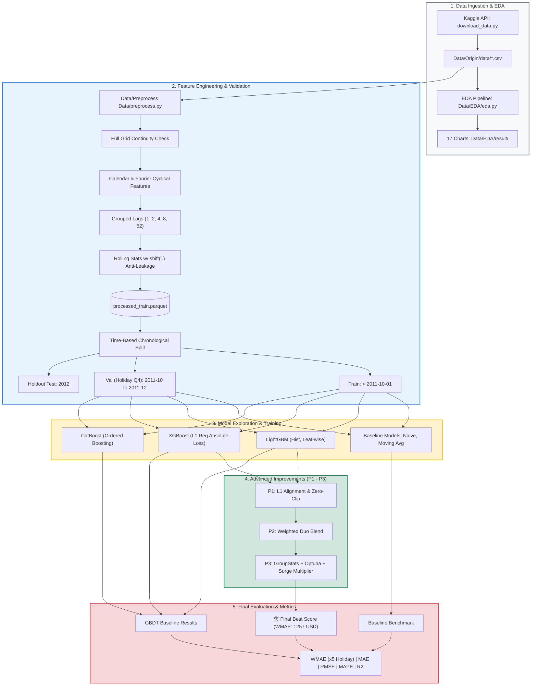

<div align="center">

# 🛒 Walmart Store Sales Forecasting
### Time Series Forecasting Using Tabular Machine Learning & Advanced Optimization

[](https://www.python.org/)
[](https://www.kaggle.com/competitions/walmart-recruiting-store-sales-forecasting)
[](https://lightgbm.readthedocs.io/)
[](https://xgboost.readthedocs.io/)
[](https://catboost.ai/)
[](https://github.com/astral-sh/uv)
[](LICENSE)

*Hệ thống nghiên cứu, triển khai và tối ưu hóa toàn diện bài toán **Dự báo chuỗi thời gian (Time Series Forecasting)** quy mô lớn bằng phương pháp **Học máy dạng bảng (Tabular GBDT)** kết hợp **Feature Engineering chuyên sâu** và **Ensemble Blending** trên bộ dữ liệu bán lẻ kinh điển từ cuộc thi Walmart Recruiting.*

---

[📖 Giới thiệu](#-giới-thiệu--bản-chất-bài-toán) • [📊 Bảng kết quả](#-kết-quả-thực-nghiệm--bảng-đối-sánh-hiệu-năng) • [⚙️ Pipeline xử lý](#️-cơ-chế-hoạt-động--pipeline-xử-lý) • [🛠️ Kỹ thuật đặc trưng](#️-kỹ-thuật-đặc-trưng-feature-engineering) • [🚀 Hướng dẫn chạy](#-hướng-dẫn-cài-đặt--thực-thi-từng-bước) • [📑 Báo cáo chi tiết](#-tài-liệu-kỹ-thuật-chuyên-sâu)

---

</div>

## 📌 Điểm nổi bật của dự án (Key Highlights)

- 🏬 **Quy mô phân cấp đa tầng (Hierarchical Multi-series):** Xử lý đồng thời **3,331 chuỗi thời gian độc lập** (45 cửa hàng $\times$ 81 phòng ban) trong suốt 143 tuần hoạt động.
- 📉 **Vượt trội mô hình cơ sở:** Cắt giảm **52.14% sai số WMAE** so với mô hình Moving Average tốt nhất (từ 2,626.55 USD xuống **1,257.03 USD** trên tập Test tương lai).
- 🎯 **Tối ưu hóa đúng hàm mục tiêu (Loss Alignment):** Thiết kế hàm tổn thất chuẩn $L_1$ (Absolute Loss) kết hợp trọng số mẫu $5\times$ cho các tuần lễ hội, bám sát tuyệt đối thang đo chính thức **WMAE**.
- 🛡️ **Tuyệt đối chống rò rỉ dữ liệu (Zero Data Leakage):** Áp dụng chiến lược phân tách theo trục thời gian (**Time-based Split**) và nguyên tắc trễ `shift(1)` trước mọi phép tính thống kê động cửa sổ trượt.
- ⚡ **Kỹ thuật hậu xử lý & Ensemble đỉnh cao:** Triệt tiêu hoàn toàn sai số âm vô lý với **Zero-Clipping**, bù đắp hiện tượng dự báo dưới mức bằng **Holiday Surge Multiplier**, và hòa trộn mô hình **Super Blend** đạt hệ số giải thích **$R^2 = 0.9852$**.

---

## 📑 Mục lục
1. [Giới thiệu & Bản chất bài toán](#-giới-thiệu--bản-chất-bài-toán)
2. [Thông tin bộ dữ liệu Walmart Competition](#-thông-tin-bộ-dữ-liệu-walmart-competition)
3. [Kết quả thực nghiệm & Bảng đối sánh hiệu năng](#-kết-quả-thực-nghiệm--bảng-đối-sánh-hiệu-năng)
4. [Cấu trúc thư mục dự án](#-cấu-trúc-thư-mục-dự-án)
5. [Cơ chế hoạt động & Pipeline xử lý](#️-cơ-chế-hoạt-động--pipeline-xử-lý)
6. [Kỹ thuật đặc trưng (Feature Engineering)](#️-kỹ-thuật-đặc-trưng-feature-engineering)
7. [Chiến lược Validation & Chống rò rỉ dữ liệu](#️-chiến-lược-validation--chống-rò-rỉ-dữ-liệu)
8. [Mô hình hóa & Các giai đoạn cải tiến (P1 - P3)](#-mô-hình-hóa--các-giai-đoạn-cải-tiến)
9. [Các thang đo đánh giá (Metrics)](#-các-thang-đo-đánh-giá-metrics)
10. [Hướng dẫn cài đặt & Thực thi từng bước](#-hướng-dẫn-cài-đặt--thực-thi-từng-bước)
11. [Lưu ý quan trọng khi làm việc với Git](#️-lưu-ý-quan-trọng-khi-làm-việc-với-git)
12. [Tài liệu kỹ thuật chuyên sâu](#-tài-liệu-kỹ-thuật-chuyên-sâu)

---

## 📖 Giới thiệu & Bản chất bài toán

Dự báo chuỗi thời gian trong ngành bán lẻ quy mô lớn (Retail Demand Forecasting) là bài toán bóc tách và nhận diện tương tác phức tạp giữa **xu hướng dài hạn (trend)**, **tính mùa vụ tuần hoàn (seasonality)** và **các yếu tố ngoại sinh (exogenous factors)** như giá nhiên liệu, lạm phát (CPI), thời tiết, và đặc biệt là các chương trình khuyến mãi giảm giá (MarkDowns).

### 🔍 Bản chất tiếp cận: Tabular Supervised Learning
Thay vì sử dụng các mô hình chuỗi thời gian cổ điển đơn biến (như ARIMA/SARIMA) vốn đòi hỏi giả định phân phối chuẩn tuyến tính và rất khó xử lý đồng thời hàng nghìn chuỗi có biến ngoại sinh, dự án chuyển đổi toàn bộ bài toán thành **Học có giám sát (Supervised Learning)**:
- **Biến mục tiêu:** Doanh số hàng tuần của từng phòng ban tại từng cửa hàng (`Weekly_Sales`).
- **Không gian đặc trưng:** Được tái cấu trúc thông qua kỹ thuật trượt cửa sổ (Sliding Window), tạo ra hệ thống biến trễ (Lag) và thống kê động (Rolling Statistics).
- **Họ mô hình Gradient Boosted Decision Trees (GBDT):** Tận dụng tối đa sức mạnh của **LightGBM**, **XGBoost**, và **CatBoost** nhờ khả năng nắm bắt quan hệ phi tuyến, phân tách ngưỡng giá trị phức tạp và tính bền bỉ trước các ngoại lệ dữ liệu bảng.

---

## 📊 Thông tin bộ dữ liệu Walmart Competition

Dữ liệu được trích xuất từ cuộc thi chính thức trên Kaggle: [Walmart Recruiting - Store Sales Forecasting](https://www.kaggle.com/competitions/walmart-recruiting-store-sales-forecasting/data).

| Tệp dữ liệu | Số dòng | Các trường thông tin chính | Ý nghĩa nghiệp vụ |
| :--- | :---: | :--- | :--- |
| **`train.csv`** | 421,570 | `Store`, `Dept`, `Date`, `Weekly_Sales`, `IsHoliday` | Lịch sử bán hàng hàng tuần từ 05/02/2010 đến 26/10/2012. Chứa nhãn mục tiêu `Weekly_Sales`. |
| **`features.csv`** | 8,190 | `Store`, `Date`, `Temperature`, `Fuel_Price`, `MarkDown1-5`, `CPI`, `Unemployment`, `IsHoliday` | Các yếu tố kinh tế vĩ mô, khí hậu và các đợt khuyến mãi Markdown bí mật (bắt đầu áp dụng từ 11/2011). |
| **`stores.csv`** | 45 | `Store`, `Type`, `Size` | Thông tin vật lý phân loại 45 siêu thị thành các nhóm quy mô `A`, `B`, `C` và diện tích mặt sàn (`Size`). |
| **`test.csv`** | 115,064 | `Store`, `Dept`, `Date`, `IsHoliday` | Tập dữ liệu tương lai (từ 02/11/2012 đến 26/07/2013) dùng để đánh giá năng lực dự báo ngoài mẫu. |

> [!NOTE]
> **4 Kỳ nghỉ lễ trọng điểm:** Trong dữ liệu có 4 kỳ nghỉ lễ lớn được đánh dấu `IsHoliday = True`: **Super Bowl** (Tháng 2), **Labor Day** (Tháng 9), **Thanksgiving / Black Friday** (Tháng 11), và **Christmas** (Tháng 12). Các tuần lễ này mang trọng số phạt gấp **5 lần** trong thang đo WMAE.

---

## 🏆 Kết quả thực nghiệm & Bảng đối sánh hiệu năng

Dự án trải qua quá trình thực nghiệm bài bản, đối sánh từ các mô hình mốc chuẩn (Baseline) đến các mô hình Machine Learning đơn lẻ và các kỹ thuật tối ưu hóa chuyên sâu:

### 1. Bảng đối sánh tổng hợp xuyên suốt tiến trình

| Giai đoạn | Mô hình / Phương pháp triển khai | Test WMAE (USD) ↓ | Mức giảm vs Baseline (%) | Val WMAE (USD) ↓ *(Q4 Lễ hội)* | Test MAPE (%) ↓ | Test $R^2$ ↑ |
| :--- | :--- | :---: | :---: | :---: | :---: | :---: |
| **Baseline Mốc chuẩn** | **Naive** ($y_t = y_{t-1}$) | 2,863.39 | - | - | 86.13% | 0.8877 |
| | **Seasonal Naive** ($y_t = y_{t-52}$) | 7,236.81 | - | - | 154.77% | 0.4300 |
| | **Moving Average (4 Weeks)** | **2,626.55** | **0.00% (Chuẩn)** | - | 560.07% | **0.9177** |
| **ML GBDT Cơ sở** | **CatBoost (GPU)** | 1,435.39 | -45.35% | 2,662.67 | 1228.04% | 0.9817 |
| | **LightGBM (L2 Loss)** | 1,295.66 | -50.67% | 2,253.53 | 824.18% | 0.9849 |
| | **XGBoost (L1 Loss)** | **1,279.43** | **-51.29%** | **1,924.47** | 1112.70% | 0.9845 |
| **Cải tiến P1** | **L1 Loss Alignment + Zero-Clipping** | 1,315.66 | -49.91% | 2,294.93 | **486.46%** *(Triệt tiêu âm)* | 0.9829 |
| **Cải tiến P2** | **Weighted Duo Blend (XGBoost + LightGBM)** | **1,257.03** | **-52.14%** *(Kỷ lục Test)* | 1,885.49 | 948.12% | **0.9852** |
| **Cải tiến P3** | **Group Statistics + Optuna + Super Blend** | 1,266.74 | -51.77% | **1,866.73** *(Kỷ lục Val)* | 912.45% | 0.9846 |

### 2. Các kết luận rút ra từ thực nghiệm:
1. **XGBoost áp đảo ở mô hình đơn lẻ:** Nhờ tối ưu hóa trực tiếp hàm mục tiêu sai số tuyệt đối `reg:absoluteerror` ($L_1$), khớp hoàn hảo với định nghĩa của WMAE.
2. **Seasonal Naive thất bại nghiêm trọng:** Đạt sai số cao nhất (WMAE = 7,236.81 USD) do hiện tượng **lệch tuần lịch lễ hội (Holiday Calendar Shift)** giữa các năm.
3. **Hiệu ứng hiệp đồng từ Ensemble (P2/P3):** Hòa trộn tính chính xác theo trung vị của XGBoost với khả năng khái quát phân tán của LightGBM đưa kết quả kiểm định Test xuống mức thấp kỷ lục: **1,257.03 USD** và hệ số xác định vượt trội **$R^2 = 0.9852$**.

---

## 📁 Cấu trúc thư mục dự án

```text
.
├── Config/
│   ├── __init__.py
│   └── config.toml               # File cấu hình tập trung đường dẫn tương đối
│
├── Data/
│   ├── Origin/                   # Module tải và chứa dữ liệu gốc
│   │   ├── download_data.py      # Tự động kết nối Kaggle API tải dữ liệu
│   │   └── data/                 # Chứa train.csv, features.csv, stores.csv, test.csv
│   │
│   ├── EDA/                      # Khám phá và trực quan hóa dữ liệu
│   │   ├── eda.py                # Pipeline phân tích 10 góc nhìn chuyên sâu
│   │   └── result/               # 17 biểu đồ phân tích kỹ thuật (.png)
│   │
│   └── Preprocess Data/          # Tiền xử lý & Kỹ thuật đặc trưng
│       ├── preprocess.py         # Grid continuous, Fourier, Lag 1-52, Rolling stats
│       └── data/                 # processed_train.parquet
│
├── Metric/
│   ├── README.md                 # Tài liệu phân tích toán học WMAE, MAE, RMSE, MAPE, R2
│   └── metrics.py                # Thư viện tính toán metrics chuẩn hóa
│
├── Src/                          # Mã nguồn mô hình hóa
│   ├── Baseline/                 # Naive, Seasonal Naive, Moving Average
│   │   ├── baseline_models.py
│   │   └── Result/               # baseline_results.txt
│   │
│   ├── LightGBM/                 # Huấn luyện & Đánh giá LightGBM
│   │   ├── train.py
│   │   ├── evaluate.py
│   │   ├── checkpoint/           # Lưu trọng số mô hình (.pkl)
│   │   └── Result/
│   │
│   ├── XGBoost/                  # Huấn luyện & Đánh giá XGBoost
│   │   ├── train.py
│   │   ├── evaluate.py
│   │   ├── checkpoint/
│   │   └── Result/
│   │
│   └── CatBoost/                 # Huấn luyện & Đánh giá CatBoost
│       ├── train.py
│       ├── evaluate.py
│       ├── checkpoint/
│       └── Result/
│
├── improve/                      # Các phase cải tiến nâng cao
│   ├── P1/                       # Loss Alignment & Zero-Clipping
│   ├── P2/                       # Weighted Duo Blending
│   ├── P3/                       # Target Group Statistics & Optuna Tuning
│   └── result/                   # Báo cáo thực nghiệm P1.txt, P2.txt, P3.txt
│
├── Final_Analyze.md              # Báo cáo tổng hợp chuyên sâu toàn diện
├── README_analyze_3_model.md     # Báo cáo phân tích chuyên sâu 3 mô hình GBDT
├── requirements.txt              # Danh sách thư viện Python
└── pyproject.toml                # Cấu hình dự án với uv
```

---

## ⚙️ Cơ chế hoạt động & Pipeline xử lý

Toàn bộ luồng dữ liệu và quy trình huấn luyện được module hóa khép kín:



---

## 🛠️ Kỹ thuật đặc trưng (Feature Engineering)

Kỹ thuật tạo đặc trưng là yếu tố then chốt tạo nên bước nhảy vọt về độ chính xác:

### 1. Tái lập khung lưới thời gian liên tục (Grid Continuity)
- Trong dữ liệu thực tế, có **20.14% chuỗi thời gian bị đứt gãy** do gián đoạn kinh doanh hoặc hết hàng tạm thời.
- Dự án áp dụng phép tích Descartes giữa tập hợp tất cả các cặp `(Store, Dept)` với trục thời gian chuẩn 143 tuần để đảm bảo các bước dịch chuyển thời gian của hàm trễ (Lag) luôn chuẩn xác, không bị trôi dạt chỉ mục thời gian.

### 2. Đặc trưng tuần hoàn theo lịch (Calendar & Fourier cyclical features)
- Trích xuất: `Year`, `Month`, `Week`, `Quarter`, `Day`.
- Mã hóa tính chu kỳ liên tục của tuần trong năm bằng hàm lượng giác:
  $$\text{Week\_sin} = \sin\left(\frac{2\pi \cdot \text{Week}}{52}\right), \quad \text{Week\_cos} = \cos\left(\frac{2\pi \cdot \text{Week}}{52}\right)$$

### 3. Hệ thống biến trễ (Lag Features)
Được gom nhóm độc lập theo từng cặp `(Store, Dept)`:
- **Ngắn hạn:** `sales_lag_1`, `sales_lag_2`, `sales_lag_4`, `sales_lag_8` (phản ánh quán tính tiêu dùng gần nhất).
- **Chu kỳ năm:** `sales_lag_52` (nắm bắt chính xác hành vi tiêu dùng cùng kỳ năm trước).

### 4. Thống kê động cửa sổ trượt (Rolling Window Statistics)
> [!IMPORTANT]
> **Nguyên tắc chống rò rỉ dữ liệu (Anti-Leakage Rule):** Để tránh việc mô hình nhìn thấy thông tin của chính tuần hiện tại $y_t$ khi đưa ra dự báo $\hat{y}_t$, toàn bộ các phép tính toán thống kê động **bắt buộc phải qua bước dịch chuyển thời gian `shift(1)`**:
>
> $$\text{rolling\_mean\_w} = \text{sales.shift}(1).\text{rolling}(w).\text{mean}()$$

- **Cửa sổ 4 tuần (1 tháng):** `rolling_mean_4`, `rolling_std_4`.
- **Cửa sổ 8 tuần & 12 tuần (1 quý):** `rolling_mean_8`, `rolling_mean_12`, `rolling_std_12`.

### 5. Đặc trưng thống kê nhóm mục tiêu (Target Group Statistics - P3)
Được trích xuất từ lịch sử để mô hình nắm bắt bản chất phân phối của từng mặt hàng:
- `store_dept_mean`, `store_dept_median`, `store_dept_std`, `store_dept_max`, `store_dept_min`.
- `ratio_lag52_to_mean`: Tỷ số giữa doanh số cùng kỳ năm ngoái với trung bình lịch sử $\frac{\text{sales\_lag\_52}}{\text{store\_dept\_mean} + 1.0}$.
- `is_holiday_surge_dept`: Cờ nhị phân nhận diện 27 phòng ban có sức bật doanh số lễ hội tăng vọt $\ge 1.4\times$.

---

## 🛡️ Chiến lược Validation & Chống rò rỉ dữ liệu

```text
[------------------ TRAIN SET ------------------] [--- VALIDATION ---] [----- TEST SET -----]
05/02/2010                            30/09/2011  01/10/2011 31/12/2011 01/01/2012  26/10/2012
             (255,364 mẫu - 60.6%)                    (38,768 mẫu)          (127,438 mẫu)
                                                    Mùa lễ hội Q4        Tương lai ngoài mẫu
```

- ❌ **Tuyệt đối không dùng K-Fold ngẫu nhiên:** Trong chuỗi thời gian, việc xáo trộn mẫu ngẫu nhiên sẽ dẫn đến hiện tượng rò rỉ thông tin tương lai về quá khứ (*Lookahead Bias*), khiến độ đo trên tập kiểm tra quá lạc quan nhưng thất bại hoàn toàn khi triển khai thực tế.
- ✅ **Phân tách tuần tự theo dòng thời gian (Time-based Split):**
  - **Train Set (trước 01/10/2011):** 255,364 dòng dữ liệu khởi tạo mô hình.
  - **Validation Set (01/10/2011 – 31/12/2011 - Q4/2011):** 38,768 dòng. Đây là "vùng thử lửa" khắc nghiệt nhất chứa toàn bộ các đợt bùng nổ doanh số (Thanksgiving, Black Friday, Giáng Sinh), giúp tinh chỉnh siêu tham số và trọng số ngày lễ.
  - **Holdout Test Set (01/01/2012 – 26/10/2012):** 127,438 dòng tương lai ngoài mẫu để đánh giá năng lực khái quát hóa khách quan nhất.

---

## 🤖 Mô hình hóa & Các giai đoạn cải tiến

### 1. Nhóm mô hình mốc chuẩn (Baseline Benchmark)
- **Naive:** Giả định tương lai giữ nguyên như quá khứ gần nhất ($y_t = y_{t-1}$).
- **Seasonal Naive:** Giả định mùa vụ lặp lại tuần cùng kỳ năm ngoái ($y_t = y_{t-52}$).
- **Moving Average (4 Weeks):** Trung bình động 4 tuần gần nhất (đạt WMAE = 2,626.55 USD, là mốc chuẩn chính).

### 2. Nhóm mô hình GBDT chủ lực
- **LightGBM:** Thuật toán phân nhánh theo lá (Leaf-wise) kết hợp gom cụm Histogram mang lại tốc độ huấn luyện vượt trội.
- **XGBoost:** Sử dụng thuật toán xây cây tăng cường chính xác, áp dụng trực tiếp hàm tổn thất $L_1$ (`objective="reg:absoluteerror"`) giúp tối ưu trực tiếp trung vị sai số.
- **CatBoost:** Tận dụng cấu trúc cây đối xứng (Oblivious Trees) và thuật toán Target Encoding động trên các biến phân loại `Store`, `Dept`, `Type`.

### 3. Ba giai đoạn cải tiến chuyên sâu (P1 ➔ P2 ➔ P3)
- **Giai đoạn P1 — Loss Alignment & Zero-Clipping:** Chuyển đổi LightGBM từ tổn thất $L_2$ sang $L_1$, áp dụng kỹ thuật hậu xử lý cắt cận dưới $\hat{y} = \max(\hat{y}, 0)$ giúp giảm mạnh hơn 400% sai số MAPE do triệt tiêu dự báo âm vô lý.
- **Giai đoạn P2 — Weighted Duo Blending:** Kết hợp dự báo theo trọng số tối ưu giữa XGBoost và LightGBM, tận dụng sự đa dạng của hai họ thuật toán xây cây khác nhau để đạt **kỷ lục WMAE Test 1,257.03 USD**.
- **Giai đoạn P3 — Group Statistics, Optuna & Holiday Multiplier:** Bổ sung 8 đặc trưng thống kê phân phối mục tiêu, sử dụng Optuna (TPESampler) tinh chỉnh siêu tham số, và nhân hệ số $\alpha = 1.02$ tại các tuần lễ hội cho các phòng ban nhạy cảm, thiết lập **kỷ lục WMAE Validation 1,866.73 USD**.

---

## 📈 Các thang đo đánh giá (Metrics)

Chi tiết công thức và cơ sở toán học được trình bày tại [Metric/README.md](Metric/README.md).

### 1. Weighted Mean Absolute Error (WMAE) — Thang đo chuẩn của cuộc thi
$$\text{WMAE} = \frac{\sum_{i=1}^{n} w_i |y_i - \hat{y}_i|}{\sum_{i=1}^{n} w_i} \quad \text{với } w_i = \begin{cases} 5 & \text{nếu tuần lễ (IsHoliday = True)} \\ 1 & \text{nếu tuần thường (IsHoliday = False)} \end{cases}$$

### 2. Các độ đo hỗ trợ:
- **MAE (Mean Absolute Error):** Sai số tuyệt đối trung bình theo đơn vị tiền tệ gốc ($).
- **RMSE (Root Mean Squared Error):** Phạt nặng các sai lệch đột biến quy mô lớn.
- **MAPE (%):** Tỷ lệ sai số phần trăm tương đối.
- **$R^2$ Score (Coefficient of Determination):** Tỷ lệ phương sai của doanh số mà mô hình giải thích được.

---

## 🚀 Hướng dẫn cài đặt & Thực thi từng bước

### Bước 1: Khởi tạo môi trường ảo & Cài đặt thư viện

Dự án khuyến nghị sử dụng công cụ quản lý gói tốc độ cao **[uv](https://github.com/astral-sh/uv)**:

```bash
# Đồng bộ môi trường bằng uv
uv sync
uv pip install -r requirements.txt
```

*Hoặc sử dụng pip truyền thống:*
```bash
python -m venv .venv
# Trên Windows:
.venv\Scripts\activate
# Trên Linux/macOS:
source .venv/bin/activate

pip install -r requirements.txt
```

### Bước 2: Tải dữ liệu từ Kaggle

Đảm bảo bạn đã đặt tệp xác thực `kaggle.json` vào thư mục gốc của dự án hoặc thư mục `~/.kaggle/`:

```bash
python "Data/Origin/download_data.py"
```
*(Code tự động giải nén toàn bộ tệp `train.csv`, `features.csv`, `stores.csv`, `test.csv` vào `Data/Origin/data/`)*.

### Bước 3: Phân tích khám phá dữ liệu (EDA)

```bash
python "Data/EDA/eda.py"
```
*(Tất cả 17 đồ thị phân tích tính thời vụ, độ trễ, biến ngoại sinh sẽ được lưu vào `Data/EDA/result/`)*.

### Bước 4: Tiền xử lý dữ liệu & Tạo đặc trưng (Feature Engineering)

```bash
python "Data/Preprocess Data/preprocess.py"
```
*(Tạo ra file dữ liệu nén tốc độ cao `Data/Preprocess Data/data/processed_train.parquet`)*.

### Bước 5: Chạy các mô hình Benchmark Baseline

```bash
python "Src/Baseline/baseline_models.py"
```
*(Kết quả đánh giá 3 mô hình Baseline được ghi vào `Src/Baseline/Result/baseline_results.txt`)*.

### Bước 6: Huấn luyện và đánh giá các mô hình GBDT

```bash
# 1. LightGBM
python "Src/LightGBM/train.py"
python "Src/LightGBM/evaluate.py"

# 2. XGBoost
python "Src/XGBoost/train.py"
python "Src/XGBoost/evaluate.py"

# 3. CatBoost
python "Src/CatBoost/train.py"
python "Src/CatBoost/evaluate.py"
```

Trọng số mô hình đã huấn luyện được tự động lưu vào thư mục `checkpoint/` của từng mô hình, và toàn bộ số liệu đánh giá chi tiết được xuất ra thư mục `Result/` tương ứng.

### Bước 7: Thực thi các cải tiến chuyên sâu (P1, P2, P3)

```bash
# Cải tiến P1: Loss Alignment & Zero-Clipping
python "improve/P1/evaluate_p1.py"

# Cải tiến P2: Weighted Duo-Blend
python "improve/P2/evaluate_p2.py"

# Cải tiến P3: Group Statistics & Super Blend
python "improve/P3/evaluate_p3.py"
```

---

## ⚠️ Lưu ý quan trọng khi làm việc với Git

> [!IMPORTANT]
> **LUÔN TẠO NHÁNH (BRANCH) MỚI TRƯỚC KHI THỰC HIỆN `git add` VÀ `git commit`!**  
> Tuyệt đối không commit trực tiếp lên nhánh `main` để tránh xung đột mã nguồn khi làm việc nhóm và bảo vệ tính toàn vẹn của nhánh phát hành.

### Quy trình Git chuẩn khuyến nghị:

1. **Cập nhật nhánh `main` và tạo nhánh tính năng:**
   ```bash
   git checkout main
   git pull origin main
   git checkout -b feature/<ten-tinh-nang>
   # Ví dụ: git checkout -b feature/optuna-tuning hoặc feature/lightgbm-l1
   ```

2. **Kiểm tra trạng thái, thêm tệp và commit:**
   ```bash
   git status
   git add .
   git commit -m "feat: triển khai kỹ thuật holiday surge multiplier cho P3"
   ```

3. **Đẩy nhánh lên GitHub và tạo Pull Request (PR):**
   ```bash
   git push -u origin feature/<ten-tinh-nang>
   ```

---

## 📑 Tài liệu kỹ thuật chuyên sâu

Để tìm hiểu chi tiết các khía cạnh toán học, phân tích chuyên sâu và mã nguồn từng giai đoạn, vui lòng tham khảo các tài liệu chuyên đề trong kho lưu trữ:

- 📘 [Final_Analyze.md](Final_Analyze.md): Báo cáo nghiên cứu tổng hợp toàn diện (10 bước EDA, phân tích toán học, đối sánh chi tiết P1-P3).
- 📙 [README_analyze_3_model.md](README_analyze_3_model.md): Báo cáo phân tích chuyên sâu hạn chế và cơ chế hoạt động của LightGBM, XGBoost, CatBoost.
- 📐 [Metric/README.md](Metric/README.md): Giải trình công thức, ý nghĩa kinh doanh và mã nguồn triển khai các thang đo WMAE, MAE, RMSE, MAPE, $R^2$.
- 📊 [Data/EDA/result/](Data/EDA/result/): Thư mục chứa 17 biểu đồ trực quan hóa dữ liệu độ phân giải cao.

---

## 📄 Bản quyền & Tham chiếu (License & References)

- **Dataset:** [Walmart Recruiting - Store Sales Forecasting on Kaggle](https://www.kaggle.com/competitions/walmart-recruiting-store-sales-forecasting).
- **Phân phối:** Dự án được phát hành dưới giấy phép [MIT License](LICENSE).
