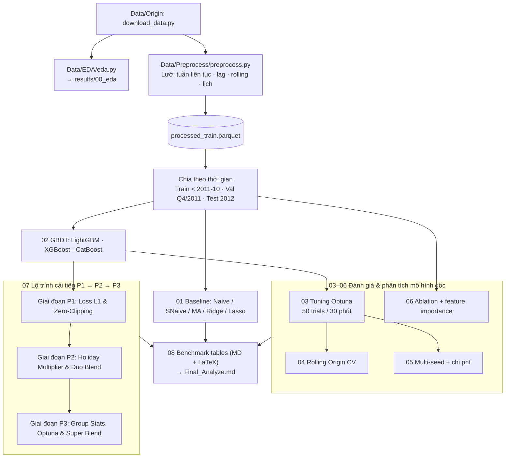

<div align="center">

# 🛒 Walmart Store Sales Forecasting
### Time Series Forecasting Using Tabular Machine Learning & Advanced Optimization (P1–P3)

[](https://www.python.org/)
[](https://www.kaggle.com/competitions/walmart-recruiting-store-sales-forecasting)
[](https://lightgbm.readthedocs.io/)
[](https://xgboost.readthedocs.io/)
[](https://catboost.ai/)
[](https://github.com/astral-sh/uv)
[](LICENSE)

*Pipeline dự báo doanh số hàng tuần cho **3,331 chuỗi thời gian** (45 cửa hàng × 81 phòng ban) của Walmart: từ baseline thống kê, mô hình tuyến tính, GBDT (LightGBM / XGBoost / CatBoost), đến lộ trình ba giai đoạn cải tiến chuyên sâu P1–P3 (đồng bộ Loss L1, Holiday Multiplier, Group Stats & Ensembling). Đánh giá bằng Rolling Origin CV, 3 random seed, ngân sách tuning đồng nhất và ablation study.*

**Môn học:** Machine Learning and Applications (CO5175) — Chủ đề 4: *Time series forecasting using machine learning*

[📊 Kết quả](#-kết-quả-chính) • [📁 Cấu trúc](#-cấu-trúc-thư-mục) • [⚙️ Pipeline](#️-pipeline-xử-lý) • [🚀 Chạy lại](#-cài-đặt--chạy-lại-toàn-bộ-kết-quả) • [📑 Báo cáo chi tiết](Final_Analyze.md)

</div>

---

## 📌 Điểm nổi bật

- 🏬 **Quy mô chuỗi thời gian:** 3,331 chuỗi Store × Dept độc lập trên 45 siêu thị Walmart toàn quốc.
- 📉 **Kết quả tốt nhất (Holdout Test 2012, 3 seed):** **P2 Weighted Duo Blend** đạt WMAE **1,264.39 ± 3.04 USD**, MASE 0.630 — thấp hơn **28.8%** so với Seasonal Naive (1,775.43) và **37.0%** so với Moving Average 4 tuần (2,006.54). Trên Validation Q4/2011 (mùa lễ), **P3 Super Blend** tốt nhất với **1,856.28 ± 38.24 USD**.
- 🎯 **Loss alignment:** hàm mất mát L1 + trọng số mẫu ×5 cho tuần lễ, khớp với thang đo WMAE của cuộc thi.
- 🛡️ **Chống rò rỉ dữ liệu:** chia theo thời gian, lưới tuần liên tục, `shift(1)` trước mọi thống kê trượt; Rolling Origin CV tái tính lag sau khi che doanh số tương lai.
- 🔬 **Thực nghiệm đúng chuẩn đề bài:** 3 seed (mean ± std), Optuna 50 trials / 30 phút cho cả 3 GBDT trên cùng không gian siêu tham số, đo phần cứng / thời gian / số tham số, ablation 5 nhóm đặc trưng.

---

## 📑 Mục lục
1. [Bài toán & dữ liệu](#-bài-toán--dữ-liệu)
2. [Kết quả chính](#-kết-quả-chính)
3. [Cấu trúc thư mục](#-cấu-trúc-thư-mục)
4. [Pipeline xử lý](#️-pipeline-xử-lý)
5. [Kỹ thuật đặc trưng](#️-kỹ-thuật-đặc-trưng)
6. [Chiến lược validation & chống rò rỉ](#️-chiến-lược-validation--chống-rò-rỉ-dữ-liệu)
7. [Mô hình & các giai đoạn cải tiến](#-mô-hình--các-giai-đoạn-cải-tiến)
8. [Thang đo đánh giá](#-thang-đo-đánh-giá)
9. [Cài đặt & chạy lại toàn bộ kết quả](#-cài-đặt--chạy-lại-toàn-bộ-kết-quả)
10. [Lưu ý khi làm việc với Git](#️-lưu-ý-khi-làm-việc-với-git)
11. [Tài liệu chi tiết](#-tài-liệu-chi-tiết)
12. [Nguồn gốc mã nguồn & khai báo công cụ AI](#-nguồn-gốc-mã-nguồn--khai-báo-công-cụ-ai)

---

## 📖 Bài toán & dữ liệu

Dự báo `Weekly_Sales` cho từng phòng ban (`Dept`) của từng cửa hàng (`Store`). Bài toán được chuyển thành **học có giám sát dạng bảng**: mỗi dòng là một cặp (Store, Dept, tuần) với đặc trưng lag, rolling, lịch, ngày lễ và biến ngoại sinh; một mô hình GBDT toàn cục học chung cho mọi chuỗi.

Dữ liệu: [Kaggle — Walmart Recruiting: Store Sales Forecasting](https://www.kaggle.com/competitions/walmart-recruiting-store-sales-forecasting/data).

| Tệp | Số dòng | Trường chính | Ý nghĩa |
| :--- | :---: | :--- | :--- |
| `train.csv` | 421,570 | `Store`, `Dept`, `Date`, `Weekly_Sales`, `IsHoliday` | Doanh số tuần 05/02/2010 – 26/10/2012 (143 tuần) |
| `features.csv` | 8,190 | `Temperature`, `Fuel_Price`, `MarkDown1-5`, `CPI`, `Unemployment` | Biến ngoại sinh; MarkDown chỉ có từ 11/2011 |
| `stores.csv` | 45 | `Store`, `Type`, `Size` | Loại cửa hàng A/B/C và diện tích |
| `test.csv` | 115,064 | `Store`, `Dept`, `Date`, `IsHoliday` | 39 tuần tương lai (không có nhãn) |

> [!NOTE]
> 4 kỳ lễ (Super Bowl, Labor Day, Thanksgiving, Christmas) có trọng số **×5** trong WMAE. Vì `test.csv` không có nhãn, mọi đánh giá dùng **Holdout Test = năm 2012** cắt từ `train.csv`.

---

## 📊 Kết quả chính

Toàn bộ số liệu dưới đây được sinh tự động bởi [`generate_benchmark_tables.py`](Src/Evaluation/generate_benchmark_tables.py) — bản đầy đủ (kèm MAPE, R², LaTeX) tại [`results/08_benchmark_tables/benchmark_tables.md`](results/08_benchmark_tables/benchmark_tables.md).

### 1. Tiến trình cải tiến P1 → P2 → P3 (3 seed: 42, 123, 2024 — mean ± std)

| Phiên bản | Ý tưởng | Val WMAE (Q4/2011) | Test WMAE (2012) | Test MASE |
| :--- | :--- | ---: | ---: | ---: |
| Benchmark | Seasonal Naive (lag 52) | 2,294.98 | 1,775.43 | 0.899 |
| Benchmark | Moving Average 4 tuần | 4,424.14 | 2,006.54 | 0.987 |
| Linear | Lasso trên lag features (thang tương đối) | 3,888.46 | 1,564.00 | 0.781 |
| ML Baseline | LightGBM (L2 loss) | 2,295.66 ± 31.38 | 1,300.67 ± 10.33 | 0.650 |
| ML Baseline | XGBoost (L1 loss) | 1,906.48 ± 54.88 | 1,280.85 ± 2.48 | 0.638 |
| P1 | LightGBM L1 + Zero-Clipping | 2,226.32 ± 10.27 | 1,304.64 ± 11.30 | 0.652 |
| **P2** | Weighted Duo Blend + Holiday Multiplier | 1,887.31 ± 51.29 | **1,264.39 ± 3.04** | **0.630** |
| P3 | LightGBM đơn + Group Stats + Optuna | 2,095.66 ± 43.55 | 1,327.43 ± 4.81 | 0.663 |
| **P3** | Super Blend (XGB + LGB P3) + Multiplier | **1,856.28 ± 38.24** | 1,268.98 ± 0.61 | 0.632 |

### 2. Đánh giá mô hình gốc (03–06)

| Thực nghiệm | Kết quả chính |
| :--- | :--- |
| **Rolling Origin CV** (4 fold × 13 tuần, `horizon_safe`) | WMAE: LightGBM 1,963.67 ± 411.77 · XGBoost 1,982.46 ± 428.65 · CatBoost 2,273.91 ± 526.09; fold Q4 luôn khó nhất |
| **3 GBDT đã tuning, 3 seed** (Test WMAE) | XGBoost 1,264.82 ± 5.31 · LightGBM 1,290.87 ± 4.64 · CatBoost 1,453.25 ± 22.96 |
| **Ablation** (XGBoost, thêm dần nhóm đặc trưng) | Nhóm lịch + cờ lễ giảm Val WMAE **−1,204 USD**; biến ngoại sinh làm tệ đi (+44) |

### 3. Các nhận định rút ra
1. **Ensemble là bước cải tiến có giá trị nhất:** P2 tốt nhất trên Test, P3 tốt nhất trên Val Q4; LightGBM P3 đơn lẻ yếu hơn XGBoost nhưng bổ trợ tốt trong blend.
2. **Đặc trưng lịch & ngày lễ quyết định độ chính xác mùa lễ** (ablation C3: −38% WMAE Validation).
3. **Mô hình tuyến tính** vượt Seasonal Naive trên Test nhưng thất bại ở Q4 vì không học được tương tác ngày lễ × phòng ban — minh chứng giá trị của GBDT.

---

## 📁 Cấu trúc thư mục

```text
.
├── Config/
│   ├── __init__.py                 # load_config(), get_result_dir(), get_checkpoint_dir(), load_experiment_config()
│   ├── config.toml                 # MỌI đường dẫn dữ liệu / checkpoints / results tập trung tại đây
│   └── experiments/                # Config riêng từng thí nghiệm: seed, split, features, CV, search space, ngân sách
│       ├── lightgbm_tuned.toml  ├── xgboost_tuned.toml  └── catboost_tuned.toml
│
├── Data/
│   ├── Origin/                     # download_data.py + data/ (CSV gốc từ Kaggle)
│   ├── EDA/eda.py                  # 10 bước EDA -> results/00_eda/
│   └── Preprocess/                 # preprocess.py + data/ (processed_train/test .parquet/.csv)
│
├── Metric/                         # metrics.py (WMAE, MAE, RMSE, MASE, MAPE, R²) + README.md
│
├── Src/                            # CHỈ chứa mã nguồn
│   ├── Baseline/                   # baseline_models.py (Naive, Seasonal Naive, MA), linear_baseline.py (Ridge/Lasso)
│   ├── LightGBM/  XGBoost/  CatBoost/   # train.py, evaluate.py
│   ├── Experiments/                # common.py, model_zoo.py, tune.py, run_multiseed.py, run_ablation.py,
│   │                               # run_improvement_multiseed.py (Hướng 1 × 3 seed)
│   ├── Evaluation/                 # time_series_cv.py, generate_benchmark_tables.py
│   └── Improvement/                # CÁC GIAI ĐOẠN CẢI TIẾN
│       └── P1/  P2/  P3/           #   L1 + Zero-Clip → Blend + Holiday Multiplier → Group Stats + Optuna
│   └── Utils/                      # system_profiler.py (phần cứng, Timer, đếm tham số)
│
├── checkpoints/                    # Trọng số mô hình đã huấn luyện
│   ├── lightgbm/  xgboost/  catboost/
│   └── p1_lightgbm_l1/  p3_lightgbm_optuna/   (kèm best_params.json của P3)
│
├── results/                        # MỌI kết quả, đánh số theo thứ tự giai đoạn của pipeline
│   ├── 00_eda/                     # 15 biểu đồ EDA + eda_analysis_and_preprocess_design.md
│   ├── 01_baseline/                # baseline_results.txt, linear_results.{txt,json}
│   ├── 02_gbdt/                    # lightgbm/ xgboost/ catboost/: metrics + submission
│   ├── 03_tuning/                  # ┐ Đánh giá & phân tích MÔ HÌNH GỐC
│   ├── 04_time_series_cv/          # │ (tuning → CV, multi-seed; ablation đặc trưng)
│   ├── 05_multiseed/               # │
│   ├── 06_ablation/                # ┘
│   ├── 07_improvement/             # CÁC GIAI ĐOẠN CẢI TIẾN
│   │   └── a_p1_p3/                #   P1.txt, P2.txt, P3.txt, improvement_multiseed.{json,md}
│   ├── 08_benchmark_tables/        # benchmark_tables.md + .tex (bảng tổng hợp cho báo cáo)
│   ├── _archive/catboost_mae_cpu/  # Kết quả CatBoost MAE/CPU (ablation hàm mất mát)
│   └── hardware_info.json
│
├── docs/
│   ├── README_analyze_3_model.md   # Phân tích chuyên sâu 3 mô hình GBDT
│   ├── plans/                      # Kế hoạch thực hiện & sinh báo cáo
│   └── specification/              # Đề bài (PDF)
│
├── Final_Analyze.md                # Báo cáo tổng hợp chi tiết
├── requirements.txt  pyproject.toml  uv.lock
└── README.md
```

---

## ⚙️ Pipeline xử lý



---

## 🛠️ Kỹ thuật đặc trưng

Toàn bộ trong [`Data/Preprocess/preprocess.py`](Data/Preprocess/preprocess.py) (44 đặc trưng) và [`Src/Improvement/P3/features_p3.py`](Src/Improvement/P3/features_p3.py) (+8 đặc trưng P3).

1. **Lưới tuần liên tục:** tích Descartes (Store, Dept) × 182 tuần; 671 chuỗi (20.14%) bị đứt gãy được điền 0 để `shift()` không lệch pha.
2. **Lịch & ngày lễ:** `Year`, `Month`, `Week`, `Quarter`, `DayOfYear`, `Week_sin/cos`, `Month_sin/cos`, cờ `is_super_bowl`, `is_labor_day`, `is_thanksgiving`, `is_christmas`, `is_pre_christmas_peak`, `weeks_to_thanksgiving`.
3. **Lag theo (Store, Dept):** ngắn hạn `sales_lag_1/2/4/8`; mùa vụ `sales_lag_51/52/53` (bộ ba xử lý lệch tuần Thanksgiving giữa các năm).
4. **Rolling (luôn `shift(1)` trước):** `sales_rolling_mean_4`, `sales_rolling_std_4`, `sales_rolling_mean_8`, `sales_rolling_mean_52`, `sales_growth_ratio_4`, `sales_to_size_ratio`.
5. **Ngoại sinh:** `Temperature`, `Fuel_Price`, `MarkDown1-5`, `Total_MarkDown`, `Has_MarkDown`, `CPI`, `Unemployment` (ffill/bfill theo Store).
6. **P3 — Target Group Statistics (tính từ Train):** `store_dept_mean/median/std/max/min`, `sales_ratio_to_store_dept_mean`, `markdown_to_size_ratio`, `is_markdown_available`.

---

## 🛡️ Chiến lược validation & chống rò rỉ dữ liệu

```text
[------------------ TRAIN ------------------] [--- VALIDATION ---] [----- HOLDOUT TEST -----]
05/02/2010                        30/09/2011  01/10/2011 31/12/2011 01/01/2012       26/10/2012
             255,364 dòng                        38,768 dòng            127,438 dòng
```

- **Không xáo trộn:** chia hoàn toàn theo thời gian; Val Q4/2011 chứa trọn mùa lễ, dùng cho early stopping và chọn siêu tham số; Test 2012 chỉ để báo cáo.
- **Rolling Origin CV** ([`time_series_cv.py`](Src/Evaluation/time_series_cv.py)) — 4 fold expanding window, mỗi fold dự báo 13 tuần:

  | Fold | Train đến | Validation |
  | :--- | :---: | :---: |
  | 1 | 2011-04-30 | 2011-05 → 2011-07 |
  | 2 | 2011-07-31 | 2011-08 → 2011-10 |
  | 3 (Q4 Holiday) | 2011-10-31 | 2011-11 → 2012-01 |
  | 4 | 2012-01-31 | 2012-02 → 2012-04 |

  Chế độ `horizon_safe`: mỗi fold che doanh số sau mốc dự báo, **tái tính lag/rolling** bằng chính hàm của `preprocess.py` và bỏ đặc trưng có độ trễ < 13 tuần; early stopping dùng 8 tuần cuối của phần train; mẫu số MASE tính lại theo fold.

---

## 🤖 Mô hình & các giai đoạn cải tiến

| Nhóm | Mô hình | Ghi chú |
| :--- | :--- | :--- |
| Baseline | Naive, Seasonal Naive, Moving Average 4W | [`baseline_models.py`](Src/Baseline/baseline_models.py) |
| Linear | Ridge, Lasso | Thang tương đối y / quy mô chuỗi, winsorize, cờ thiếu lịch sử; alpha chọn trên Val — [`linear_baseline.py`](Src/Baseline/linear_baseline.py) |
| GBDT | LightGBM (L2), XGBoost (L1, GPU), CatBoost (RMSE, GPU) | [`Src/LightGBM`](Src/LightGBM), [`Src/XGBoost`](Src/XGBoost), [`Src/CatBoost`](Src/CatBoost) |
| Cải tiến P1 | LightGBM `regression_l1` + Zero-Clipping | [`Src/Improvement/P1`](Src/Improvement/P1) |
| Cải tiến P2 | Blend XGB + LGB (tối ưu WMAE Val) + Thanksgiving Multiplier α = 1.02 | [`Src/Improvement/P2`](Src/Improvement/P2) |
| Cải tiến P3 | 8 đặc trưng thống kê nhóm + Optuna tuning + Super Blend | [`Src/Improvement/P3`](Src/Improvement/P3) |


---

## 📈 Thang đo đánh giá

Chi tiết tại [`Metric/README.md`](Metric/README.md).

- **WMAE** (thang đo chính): $\frac{\sum w_i|y_i-\hat{y}_i|}{\sum w_i}$, $w_i=5$ tuần lễ, $1$ tuần thường.
- **MASE:** $\frac{\text{MAE}}{\frac{1}{N-m}\sum_{t>m}|y_t-y_{t-m}|}$, $m=52$; mẫu số gộp từ 3,331 chuỗi trên lưới tuần liên tục của tập train. MASE < 1 = tốt hơn Seasonal Naive trong mẫu.
- **MAE, RMSE, MAPE, R²** — MAPE chỉ mang tính tham khảo vì bùng nổ khi doanh số ≈ 0.

---

## 🚀 Cài đặt & chạy lại toàn bộ kết quả

### 1. Môi trường & dữ liệu

```bash
uv sync && uv pip install -r requirements.txt      # hoặc: python -m venv .venv && pip install -r requirements.txt
python Data/Origin/download_data.py                # cần kaggle.json ở thư mục gốc hoặc ~/.kaggle/
```

> [!WARNING]
> `kaggle.json` chứa API key cá nhân và đã được đưa vào `.gitignore` — **không commit file này**.

### 2. Chạy theo giai đoạn

Mọi đường dẫn đọc từ [`Config/config.toml`](Config/config.toml); kết quả mỗi bước nằm trong thư mục `results/` tương ứng.

| Giai đoạn | Lệnh | Kết quả |
| :--- | :--- | :--- |
| 00 EDA | `python Data/EDA/eda.py` | `results/00_eda/` |
| Tiền xử lý | `python Data/Preprocess/preprocess.py` | `Data/Preprocess/data/` |
| 01 Baseline | `python Src/Baseline/baseline_models.py`<br/>`python Src/Baseline/linear_baseline.py` | `results/01_baseline/` |
| 02 GBDT | `python Src/<LightGBM\|XGBoost\|CatBoost>/train.py`<br/>`python Src/<...>/evaluate.py` | `checkpoints/<model>/`, `results/02_gbdt/<model>/` |
| 03 Tuning | `python Src/Experiments/tune.py` | `results/03_tuning/` |
| 04 Rolling Origin CV | `python Src/Evaluation/time_series_cv.py` | `results/04_time_series_cv/` |
| 05 Multi-seed | `python Src/Experiments/run_multiseed.py` | `results/05_multiseed/` |
| 06 Ablation | `python Src/Experiments/run_ablation.py` | `results/06_ablation/` |
| 07 Cải tiến P1–P3 | `python Src/Improvement/P1/run_p1.py` (tương tự `P2/run_p2.py`, `P3/run_p3.py`)<br/>`python Src/Experiments/run_improvement_multiseed.py` (tái lập × 3 seed) | `checkpoints/p1_*`, `p3_*`<br/>`results/07_improvement/a_p1_p3/` |
| 08 Bảng báo cáo | `python Src/Evaluation/generate_benchmark_tables.py --update-docs` | `results/08_benchmark_tables/` + cập nhật `Final_Analyze.md` |

**Thứ tự phụ thuộc:** 03 trước 04/05 (tự dùng siêu tham số đã tuning nếu có). Trong 07: `run_p3.py` trước `run_improvement_multiseed.py` (cần `best_params.json` của P3). 08 chạy cuối.

**Chạy thử nhanh:** `linear_baseline.py` và mọi script ở giai đoạn 03–08 (trừ `run_p*.py`) nhận cờ `--quick` (10% chuỗi, ít cây) và ghi ra file `*_quick` riêng (đã được `.gitignore`).

### 3. Tái lập

- **Seed:** `[seeds] values = [42, 123, 2024]` trong từng file `Config/experiments/*.toml`; Optuna `sampler_seed = 42`.
- **Phần cứng** (tự ghi vào [`results/hardware_info.json`](results/hardware_info.json)): Intel i7-12700H (14 nhân / 20 luồng), 32 GB RAM, NVIDIA RTX 3050 Laptop 4 GB. XGBoost/CatBoost tự dùng CUDA nếu có (`[device] type = "auto"`), nên kết quả GPU/CPU có thể chênh nhẹ.
- **Thời gian tham khảo:** tuning 3 mô hình ≈ 1.5 giờ; chuỗi cải tiến × 3 seed ≈ 25–40 phút; ablation ≈ 8 phút.

---

## ⚠️ Lưu ý khi làm việc với Git

> [!IMPORTANT]
> **Luôn tạo nhánh mới trước khi `git add` / `git commit`** — không commit trực tiếp lên `main`.

```bash
git checkout main && git pull origin main
git checkout -b feature/<ten-tinh-nang>
git add . && git commit -m "feat: ..."
git push -u origin feature/<ten-tinh-nang>        # rồi tạo Pull Request
```

`Data/Preprocess/data/processed_train.csv` (> 100 MB) được quản lý bằng **Git LFS** (xem `.gitattributes`).

---

## 📑 Tài liệu chi tiết

- 📘 [Final_Analyze.md](Final_Analyze.md) — báo cáo tổng hợp: EDA 10 bước, phương pháp, toàn bộ bảng kết quả.
- 📙 [docs/README_analyze_3_model.md](docs/README_analyze_3_model.md) — phân tích chuyên sâu LightGBM, XGBoost, CatBoost.
- 📐 [Metric/README.md](Metric/README.md) — công thức và ý nghĩa các thang đo.
- 📊 [results/08_benchmark_tables/benchmark_tables.md](results/08_benchmark_tables/benchmark_tables.md) — các bảng đối sánh (kèm `.tex`).
- 🖼️ [results/00_eda/](results/00_eda/) — biểu đồ EDA; [results/06_ablation/feature_importance.png](results/06_ablation/feature_importance.png).

---

## 🧾 Nguồn gốc mã nguồn & khai báo công cụ AI

### Phần nhóm tự thiết kế và hiện thực

| Thành phần | Mã nguồn |
| :--- | :--- |
| EDA 10 bước | `Data/EDA/eda.py` |
| Lưới tuần liên tục, đặc trưng lịch / lag / rolling | `Data/Preprocess/preprocess.py` |
| Thang đo WMAE, MASE (panel) | `Metric/metrics.py` |
| Baseline, LightGBM, XGBoost, CatBoost với trọng số WMAE | `Src/Baseline/`, `Src/LightGBM/`, `Src/XGBoost/`, `Src/CatBoost/` |
| Các giai đoạn cải tiến: P1, P2, P3 | `Src/Improvement/` |
| Rolling Origin CV, tuning đồng nhất, đa seed, ablation, đo phần cứng | `Src/Evaluation/`, `Src/Experiments/`, `Src/Utils/` |
| Bảng đối sánh tự động | `Src/Evaluation/generate_benchmark_tables.py` |

> [!NOTE]
> **Khai báo công cụ AI (Mục 4.4 đề bài):** các module đánh giá mở rộng (`Src/Evaluation/`, `Src/Experiments/`, `Src/Utils/`, `Src/Baseline/linear_baseline.py`, `Config/experiments/`, hàm MASE) và việc tái cấu trúc thư mục được hiện thực theo kế hoạch của nhóm với sự hỗ trợ của trợ lý lập trình AI (Claude Code). Nhóm chịu trách nhiệm rà soát, chạy thực nghiệm và diễn giải kết quả.

### Tài liệu & thư viện tham khảo

| Nguồn | Sử dụng |
| :--- | :--- |
| [Kaggle — Walmart Recruiting](https://www.kaggle.com/competitions/walmart-recruiting-store-sales-forecasting) | Dữ liệu, định nghĩa WMAE |
| [LightGBM](https://lightgbm.readthedocs.io/), [XGBoost](https://xgboost.readthedocs.io/), [CatBoost](https://catboost.ai/docs/), [Optuna](https://optuna.readthedocs.io/), scikit-learn | Thư viện mô hình & tối ưu (API chính thức) |
| Hyndman & Athanasopoulos, *[Forecasting: Principles and Practice](https://otexts.com/fpp3/)* (3rd ed.) | MASE, time-series CV |
| Hyndman & Koehler (2006), IJF 22(4) | Định nghĩa MASE |

---

## 📄 License

Dataset thuộc [Kaggle Walmart Recruiting](https://www.kaggle.com/competitions/walmart-recruiting-store-sales-forecasting). Mã nguồn phát hành theo [MIT License](LICENSE).
