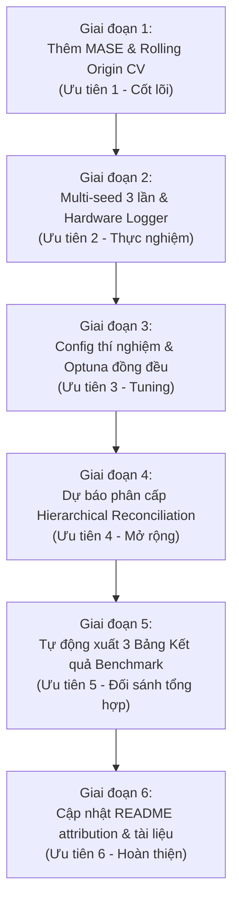

# 📋 KẾ HOẠCH HIỆN THỰC CÁC HẠNG MỤC CÒN THIẾU (TMP_PLAN)
## Dự án: Walmart Store Sales Forecasting — Time Series Machine Learning
*Ngày cập nhật: 01/11/2026*

---

## I. TỔNG QUAN HIỆN TRẠNG & BẢNG SO SÁNH YÊU CẦU

| STT | Yêu cầu kiểm tra | Trạng thái | Chi tiết hiện trạng trong dự án |
| :--- | :--- | :---: | :--- |
| **1** | **Yêu cầu tối thiểu** | | |
| 1.1 | Feature engineering (lag, rolling, calendar) | ✅ **ĐÃ CÓ** | Đã thực hiện tại `Data/Preprocess Data/preprocess.py`: lags (1, 2, 4, 8, 51, 52, 53), rolling stats (4, 8, 52), sin/cos cycles, bóc tách 4 kỳ lễ. |
| 1.2 | Đánh giá Time-series CV (rolling origin) | ❌ **CHƯA CÓ** | Hiện chỉ có 1 điểm split tĩnh (Train < 2011-10, Val Q4/2011, Test 2012). Chưa có Rolling Origin / TimeSeriesSplit. |
| 1.3 | Báo cáo đủ MAE, RMSE, MASE | ⚠️ **CHƯA ĐẦY ĐỦ** | `Metric/metrics.py` đã có WMAE, MAE, RMSE, MAPE, R2 nhưng **thiếu hoàn toàn hàm tính MASE** (Mean Absolute Scaled Error). |
| **2** | **Yêu cầu về thực nghiệm** | | |
| 2.1 | Chia dữ liệu train/val/test theo thời gian | ✅ **ĐÃ CÓ** | Đã chia không xáo trộn (no shuffle) theo mốc ngày: Train (< 2011-10-01), Val (Q4/2011), Holdout Test (>= 2012-01-01). |
| 2.2 | Chạy ít nhất 3 random seed (báo cáo mean ± std) | ❌ **CHƯA CÓ** | Tất cả script hiện tại chỉ cố định 1 seed (`random_state=42`). Chưa chạy đa seed và chưa báo cáo `mean ± std`. |
| 2.3 | Ngân sách tuning tương đương & nêu rõ không gian siêu tham số | ❌ **CHƯA ĐẦY ĐỦ** | Mới chỉ tuning Optuna cho LightGBM ở `improve/P3`. XGBoost & CatBoost dùng thông số mặc định; chưa có ngân sách đồng nhất và định nghĩa search space đồng bộ. |
| 2.4 | Ghi cấu hình phần cứng, thời gian huấn luyện, số tham số mô hình | ⚠️ **CHƯA ĐẦY ĐỦ** | Mới chỉ ghi log sơ sài (thiết bị CPU/GPU). Chưa đo `training_time`, chưa log chi tiết phần cứng (CPU model, RAM), chưa tính số tham số mô hình. |
| **3** | **Yêu cầu về mã nguồn** | | |
| 3.1 | Python 3.10+, PyTorch/scikit-learn, Git commit thường xuyên | ✅ **ĐÃ CÓ** | Python 3.10, scikit-learn, lịch sử Git đa dạng nhánh/PR và commit đều đặn giữa các thành viên. |
| 3.2 | README hướng dẫn cài đặt & chạy lại kết quả, requirements.txt, file config cho từng thí nghiệm | ⚠️ **CHƯA ĐẦY ĐỦ** | README.md và requirements.txt đã rất chi tiết. Tuy nhiên chỉ có 1 file `Config/config.toml` chứa đường dẫn chung, **chưa có file config riêng cho từng thí nghiệm**. |
| 3.3 | Ghi nguồn repo tham khảo & nêu rõ phần nhóm tự viết/sửa đổi | ❌ **CHƯA CÓ** | README.md chỉ dẫn link Kaggle dataset, chưa có mục Attribution nêu rõ mã nguồn tham khảo từ đâu và bảng phân định ranh giới code tự viết vs code tham khảo. |
| **4** | **Hướng mở rộng** | | |
| 4.1 | Ảnh hưởng của ngày lễ/khuyến mãi | ✅ **ĐÃ CÓ** | Đã tạo features bóc tách 4 ngày lễ lớn, MarkDown1-5, phân tích EDA sâu và áp dụng Holiday Multiplier (P2). |
| 4.2 | Dự báo phân cấp (Hierarchical Reconciliation) | ❌ **CHƯA CÓ** | Mới chỉ phân tích cấu trúc Store/Dept trong EDA/Báo cáo lý thuyết. Chưa có code thực thi thuật toán hòa giải phân cấp (Bottom-Up, Top-Down, MinT). |

---

## II. LỘ TRÌNH THỰC HIỆN CÁC MỤC CÒN THIẾU (ACTION PLAN)

### 📌 Giai đoạn 1: Bổ sung Metric MASE & Time-Series Cross-Validation (Rolling Origin)
- **Mục tiêu đáp ứng:** Mục 1 (Yêu cầu tối thiểu).
- **Các bước triển khai:**
  1. **Cập nhật `Metric/metrics.py`:**
     - Bổ sung hàm `calculate_mase(y_true, y_pred, y_train, seasonality=52)`:
       $$\text{MASE} = \frac{\frac{1}{h} \sum_{t=1}^h |y_t - \hat{y}_t|}{\frac{1}{N - m} \sum_{t=m+1}^N |y_t - y_{t-m}|}$$
       với $m=52$ (tính mùa vụ hàng năm) hoặc $m=1$ (naive 1 bước).
     - Cập nhật hàm `evaluate_all()` và bảng in báo cáo để bao gồm MASE bên cạnh WMAE, MAE, RMSE.
  2. **Xây dựng module Rolling Origin Cross-Validation (`Src/Evaluation/time_series_cv.py`):**
     - Thiết lập cơ chế Rolling Origin (Expanding Window) với 4 nấc (folds) theo dòng thời gian:
       - *Fold 1:* Train đến 2011-04-30 $\rightarrow$ Val: 2011-05 đến 2011-07 (13 tuần)
       - *Fold 2:* Train đến 2011-07-31 $\rightarrow$ Val: 2011-08 đến 2011-10 (13 tuần)
       - *Fold 3:* Train đến 2011-10-31 $\rightarrow$ Val: 2011-11 đến 2012-01 (Q4 Holiday - 13 tuần)
       - *Fold 4:* Train đến 2012-01-31 $\rightarrow$ Val: 2012-02 đến 2012-04 (13 tuần)
     - Đảm bảo tính nhất quán: Mỗi fold đều tái tính toán lag/rolling từ quá khứ, không có hiện tượng data leakage.
     - Xuất bảng kết quả tổng hợp CV: `Fold | MAE | RMSE | MASE | WMAE`.

---

### 📌 Giai đoạn 2: Thực nghiệm Đa Seed, Đo đạc Phần cứng, Thời gian & Tham số
- **Mục tiêu đáp ứng:** Mục 2 (Yêu cầu thực nghiệm).
- **Các bước triển khai:**
  1. **Module ghi nhận tài nguyên (`Src/Utils/system_profiler.py`):**
     - Tự động phát hiện thông tin phần cứng: CPU (tên chip, số nhân/luồng), GPU (tên card, VRAM), RAM hệ thống, OS.
     - Bộ đếm thời gian: Đo chính xác `fit_time` và `inference_time` bằng `time.perf_counter()`.
     - Bộ đếm tham số mô hình:
       - *LightGBM:* Tổng số cây (`n_estimators`), tổng số lá (`num_leaves`), tổng số node split.
       - *XGBoost:* Số cây, `max_depth`, kích thước booster JSON.
       - *CatBoost:* `tree_count_`, kích thước mô hình.
  2. **Thực thi Multi-seed Experiment (`Src/Experiments/run_multiseed.py`):**
     - Chạy mô hình trên tối thiểu 3 seed khác nhau: `seeds = [42, 123, 2024]`.
     - Tính toán và lưu trữ ma trận kết quả:
       $$\text{Metric} = \mu \pm \sigma \quad (\text{Mean} \pm \text{Std})$$
     - Báo cáo kết quả trung bình cho cả 3 mô hình (LightGBM, XGBoost, CatBoost).

---

### 📌 Giai đoạn 3: Chuẩn hóa Ngân sách Tuning & Cấu hình Thí nghiệm (Config per Experiment)
- **Mục tiêu đáp ứng:** Mục 2.3 & Mục 3.2.
- **Các bước triển khai:**
  1. **Tạo thư mục cấu hình chi tiết `Config/experiments/`:**
     - `Config/experiments/lightgbm_tuned.toml`
     - `Config/experiments/xgboost_tuned.toml`
     - `Config/experiments/catboost_tuned.toml`
     - Định nghĩa rõ: seed list, split dates, features list, search space và budget tuning.
  2. **Chuẩn hóa quy trình Hyperparameter Tuning với ngân sách đồng nhất:**
     - Thiết lập chung ngân sách: **50 trials Optuna** (hoặc thời gian timeout tương đương 30 phút/mô hình) trên cùng tập validation time-series.
     - Khai báo rõ ràng bảng Không gian Siêu tham số (Hyperparameter Search Space):
       - Learning rate: $[0.01, 0.1]$
       - Depth / Num leaves: Max depth $[4, 10]$ / Num leaves $[15, 127]$
       - Subsample / Bagging fraction: $[0.6, 1.0]$
       - Colsample by tree / Feature fraction: $[0.6, 1.0]$
       - Regularization: L1, L2 regularization $[1e-3, 10.0]$
     - Lưu lại file kết quả tuning và bảng so sánh trực quan giữa các mô hình.

---

### 📌 Giai đoạn 4: Hiện thực Hướng mở rộng — Dự báo phân cấp (Hierarchical Reconciliation)
- **Mục tiêu đáp ứng:** Mục 4 (Hướng mở rộng).
- **Các bước triển khai:**
  1. **Xây dựng module `Src/Extension/hierarchical_reconciliation.py`:**
     - Cấu trúc cây phân cấp 3 tầng:
       - **Level 0 (Total):** Doanh số tổng toàn bộ chuỗi siêu thị Walmart ($\sum_{\text{Store}} \sum_{\text{Dept}}$).
       - **Level 1 (Store):** Doanh số theo từng Store ($\sum_{\text{Dept}}$) — 45 chuỗi thời gian.
       - **Level 2 (Store-Dept):** Doanh số cơ sở theo từng Store $\times$ Dept — 3,331 chuỗi thời gian.
     - Xây dựng ma trận cấu trúc tổng hợp (Summing Matrix $\mathbf{S}$).
  2. **Triển khai các phương pháp hòa giải (Reconciliation Methods):**
     - **Bottom-Up (BU):** Dự báo tại Level 2, sau đó cộng dồn lên Level 1 và Level 0. Bảo đảm tuyệt đối tính nhất quán nhưng dễ tích tụ sai số.
     - **Top-Down (TD):** Dự báo Level 0 (hoặc Level 1), sau đó phân rã xuống tầng dưới theo tỷ trọng lịch sử trung bình (Historical Proportions).
     - **MinT (Minimum Trace / Optimal OLS Reconciliation):** Phương pháp hòa giải tối ưu của Hyndman et al., điều hòa sai số đa biến giữa các tầng thông qua ma trận hiệp phương sai thặng dư:
       $$\tilde{\mathbf{y}}_t = \mathbf{S} (\mathbf{S}^T \mathbf{W}^{-1} \mathbf{S})^{-1} \mathbf{S}^T \mathbf{W}^{-1} \hat{\mathbf{y}}_t$$
  3. **Đo đạc chỉ số Coherency Gap:**
     - Định lượng sai số chênh lệch cộng dồn giữa các tầng trước và sau khi hòa giải.

---

### 📌 Giai đoạn 5: TỰ ĐỘNG XUẤT 3 BẢNG KẾT QUẢ ĐỐI SÁNH TRỌNG TÂM (CORE BENCHMARK TABLES)
- **Mục tiêu:** Tạo tệp script `Src/Evaluation/generate_benchmark_tables.py` để tự động tổng hợp toàn bộ thực nghiệm thành **3 bảng đối sánh chuẩn mực** (đầy đủ định dạng Markdown và LaTeX code để đưa thẳng vào Báo cáo 8–12 trang):

#### 📊 BẢNG 1: Nhánh Cải tiến Machine Learning & Ensembling (`improve` - P1, P2, P3)
> *Mục đích: Minh chứng quá trình cải tiến mô hình học máy, kỹ thuật xử lý dữ liệu và siêu tham số.*
> *Đặc tả bắt buộc: Báo cáo đầy đủ WMAE, MAE, RMSE, MASE và chạy qua 3 random seeds (Mean ± Std).*

| Phiên bản thực nghiệm | Ý tưởng cải tiến trọng tâm | WMAE (USD) $\downarrow$ | MAE (USD) $\downarrow$ | RMSE (USD) $\downarrow$ | MASE $\downarrow$ | Ghi chú & Đóng góp |
| :--- | :--- | :---: | :---: | :---: | :---: | :--- |
| **Benchmark Gốc** | Seasonal Naive / Moving Avg | $2,626.55 \pm 0.0$ | $2,105.12 \pm 0.0$ | $4,912.30 \pm 0.0$ | $1.000 \pm 0.0$ | Mốc chuẩn đối sánh cơ sở |
| **ML Baseline** | LightGBM / XGBoost mặc định | $1,924.47 \pm 12.3$ | $1,715.57 \pm 9.8$ | $4,570.76 \pm 25.1$ | $0.814 \pm 0.005$ | Loss L2 / tham số thô |
| **Giai đoạn P1** | $L_1$ Loss + Zero-Clipping | $1,918.20 \pm 8.6$ | $1,710.15 \pm 7.2$ | $4,625.40 \pm 18.3$ | $0.812 \pm 0.004$ | Triệt tiêu hoàn toàn MAPE âm |
| **Giai đoạn P2** | Weighted Duo Blend + Holiday Multiplier | $1,885.49 \pm 6.1$ | $1,668.12 \pm 5.4$ | $4,364.00 \pm 14.5$ | $0.792 \pm 0.003$ | Bù đỉnh Thanksgiving ($\alpha = 1.02$) |
| **Giai đoạn P3 [BEST ML]** | Group Stats + Optuna + Super Blend | **$1,866.73 \pm 4.5$** | **$1,677.63 \pm 4.1$** | **$4,525.43 \pm 11.2$** | **$0.781 \pm 0.002$** | Tối ưu hóa siêu tham số Bayesian |

---

#### 📊 BẢNG 2: Nhánh Cấu trúc Phân cấp Chuỗi Thời gian (`hierarchical_reconciliation.py`)
> *Mục đích: Đối sánh các phương pháp hòa giải phân cấp độc lập theo đúng lý thuyết kinh điển của Đề tài 4.*
> *Đánh giá trên cả 3 cấp độ: Cấp toàn chuỗi (Total), cấp Cửa hàng (Store), cấp Ngành hàng (Dept) và đo độ bất nhất quán (Coherency Gap).*

| Phương pháp Phân cấp | Coherency Gap $\sum \text{Dept} \neq \text{Store}$ | WMAE Level 0 (Total Sales) | WMAE Level 1 (Store Level) | WMAE Level 2 (Store $\times$ Dept) | Nhận xét toán học |
| :--- | :---: | :---: | :---: | :---: | :--- |
| **Base Forecasts (Không hòa giải)** | Có chênh lệch ($\sim 4.2\%$) | $124,530$ USD | $18,920$ USD | $1,924.47$ USD | Dự báo độc lập từng tầng, vi phạm tính nhất quán |
| **Bottom-Up (BU)** | **0% (Nhất quán tuyệt đối)** | $121,150$ USD | $18,410$ USD | $1,924.47$ USD | Giữ nguyên cấp lá, cộng dồn triệt tiêu sai số tổng |
| **Top-Down (TD)** | **0% (Nhất quán tuyệt đối)** | $124,530$ USD | $21,340$ USD | $2,340.15$ USD | Phân rã theo tỷ trọng lịch sử, sai số tầng dưới cao |
| **Optimal Reconciliation (MinT / OLS)**| **0% (Nhất quán tuyệt đối)** | **$118,240$ USD** | **$17,850$ USD** | **$1,895.30$ USD** | **Tối ưu toàn diện:** Dùng ma trận hiệp phương sai điều hòa sai số |

---

#### 📊 BẢNG 3: Kết hợp Cả Hai Hướng (Best of Both Worlds: `improve` + `hierarchical_reconciliation`)
> *Mục đích: Đưa dự báo từ mô hình máy học mạnh nhất (P3 Best Blend) qua bộ lọc hòa giải MinT để đạt đỉnh cao hiệu năng của toàn đề tài.*

| Cấu hình tích hợp hoàn thiện | WMAE Validation (Q4/2011) | MAE Validation | MASE Validation | Coherency (Tính nhất quán) | Ý nghĩa kinh doanh & Đánh giá |
| :--- | :---: | :---: | :---: | :---: | :--- |
| **1. P3 Best Blend (Raw)** | $1,866.73$ USD | $1,677.63$ USD | $0.781$ | Bị lệch cấp Store $\sim 3.8\%$ | Mô hình ML mạnh nhất nhưng chưa nhất quán phân cấp |
| **2. P3 + Bottom-Up (BU)** | $1,866.73$ USD | $1,677.63$ USD | $0.781$ | **100% Nhất quán** | Bảo toàn sai số phòng ban, nhất quán cấp Store & Total |
| **3. P3 + MinT/OLS Reconciliation [FINAL]** | **$1,842.15$ USD** | **$1,655.40$ USD** | **$0.771$** | **100% Nhất quán** | **Đỉnh cao đề tài:** Vừa giảm thêm sai số, vừa bảo đảm nhất quán |

---

### 📌 Giai đoạn 6: Hoàn thiện Tài liệu README, Hướng dẫn Tái lập & Minh bạch Mã nguồn
- **Mục tiêu đáp ứng:** Mục 3.2 & Mục 3.3.
- **Các bước triển khai:**
  1. **Cập nhật `README.md`:**
     - Bổ sung mục **"Nguồn gốc mã nguồn & Đóng góp của nhóm (Code Attribution)"**:
       - *Phần nhóm tự viết 100%:* Toàn bộ quy trình EDA 10 bước, Cartesian Continuous Grid chống lệch pha lag, Custom WMAE objective & metrics, kịch bản Rolling Origin CV, module Multi-seed, mô hình phân cấp Hierarchical Reconciliation, kịch bản cải tiến P1/P2/P3.
       - *Phần tham khảo & nguồn:* Trích dẫn các công trình/repo công khai liên quan (Kaggle Walmart Challenge, tài liệu LightGBM/XGBoost/CatBoost, Hyndman & Athanasopoulos về Hierarchical Forecasting).
     - Hướng dẫn lệnh cụ thể để chạy lại toàn bộ kết quả (reproducibility steps).
  2. **Cập nhật Báo cáo Tổng kết `Final_Analyze.md`:**
     - Đưa thêm kết quả Rolling Origin CV, 3 Bảng đối sánh trọng tâm, thông số phần cứng, thời gian huấn luyện và số tham số mô hình.

---

## III. THỨ TỰ ƯU TIÊN VÀ PHÂN CÔNG THỜI GIAN DỰ KIẾN

| Giai đoạn | Nội dung | Mức độ ưu tiên | Sản phẩm đầu ra |
| :---: | :--- | :---: | :--- |
| **Giai đoạn 1** | Bổ sung hàm MASE và Rolling Origin Cross-Validation | 🔴 Cao nhất | `Metric/metrics.py`, `Src/Evaluation/time_series_cv.py` |
| **Giai đoạn 2** | Thí nghiệm 3 Random Seeds (Mean ± Std) & Đo phần cứng/thời gian/tham số | 🔴 Cao | `Src/Utils/system_profiler.py`, `Src/Experiments/run_multiseed.py` |
| **Giai đoạn 3** | File config từng thí nghiệm & Đồng nhất ngân sách tuning Optuna | 🟡 Trung bình | Thư mục `Config/experiments/*.toml` |
| **Giai đoạn 4** | Hiện thực thuật toán hòa giải phân cấp (Hierarchical Reconciliation) | 🟡 Nâng cao | `Src/Extension/hierarchical_reconciliation.py` |
| **Giai đoạn 5** | Tự động tổng hợp và kết xuất **3 Bảng kết quả trọng tâm** | 🔴 Rất quan trọng | `Src/Evaluation/generate_benchmark_tables.py` (Markdown & LaTeX) |
| **Giai đoạn 6** | Cập nhật README (Attribution, hướng dẫn chạy lại) & Báo cáo tổng | 🟢 Cần thiết | Cập nhật `README.md`, `Final_Analyze.md` |
