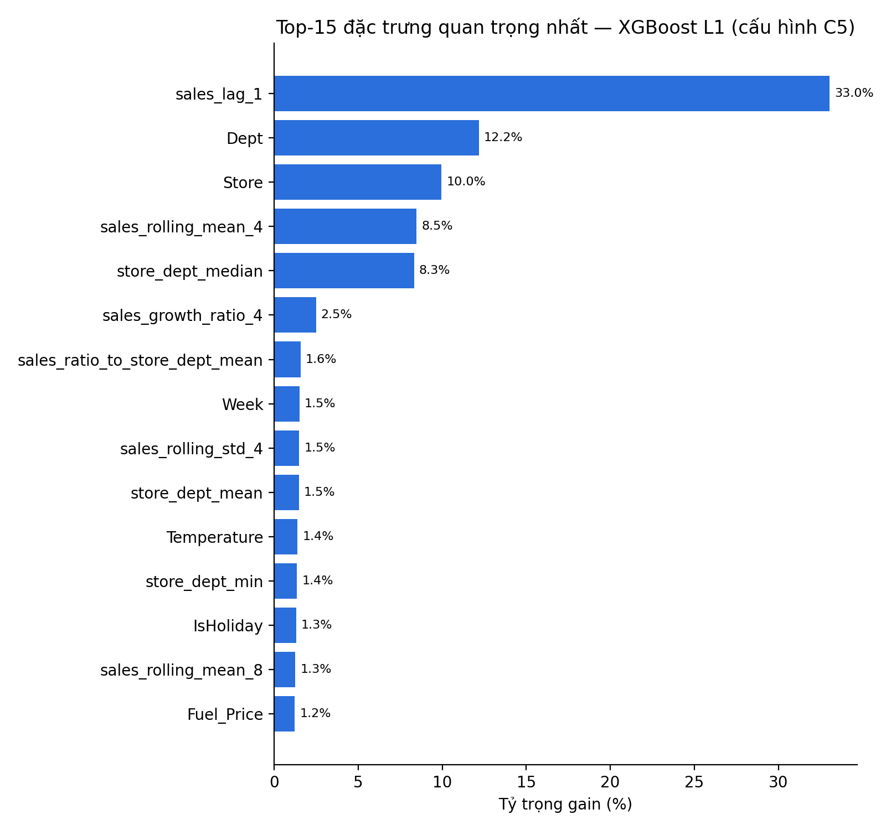

# Ablation study — XGBoost L1, 3 seed [42, 123, 2024] (mean ± std)

Thêm dần từng nhóm đặc trưng; Δ = thay đổi Val WMAE so với cấu hình liền trước.

| Cấu hình | Nhóm đặc trưng | #Đặc trưng | Val WMAE | Δ Val WMAE | Val MASE | Test WMAE | Test MASE |
| :--- | :--- | ---: | ---: | ---: | ---: | ---: | ---: |
| C1 | Lags | 12 | 3,162.87 ± 42.88 |  | 1.191 ± 0.016 | 1,359.98 ± 6.20 | 0.676 ± 0.002 |
| C2 | + Rolling | 18 | 3,060.47 ± 32.80 | -102.39 | 1.147 ± 0.014 | 1,351.88 ± 1.94 | 0.671 ± 0.001 |
| C3 | + Calendar & holiday flags | 33 | 1,856.31 ± 43.36 | -1,204.16 | 0.825 ± 0.010 | 1,267.93 ± 2.95 | 0.630 ± 0.001 |
| C4 | + Exogenous (bộ đầy đủ) | 44 | 1,900.69 ± 48.32 | +44.37 | 0.854 ± 0.018 | 1,281.69 ± 3.66 | 0.638 ± 0.002 |
| C5 | + Target Group Stats (P3) | 52 | 1,838.52 ± 2.46 | -62.17 | 0.844 ± 0.005 | 1,311.60 ± 3.06 | 0.653 ± 0.001 |

## Top-10 feature importance (cấu hình C5, seed đầu tiên)

| # | Đặc trưng | Gain (%) | Split count (%) |
| ---: | :--- | ---: | ---: |
| 1 | sales_lag_1 | 33.03% | 3.71% |
| 2 | Dept | 12.18% | 17.53% |
| 3 | Store | 9.96% | 16.83% |
| 4 | sales_rolling_mean_4 | 8.47% | 1.61% |
| 5 | store_dept_median | 8.32% | 1.06% |
| 6 | sales_growth_ratio_4 | 2.49% | 5.81% |
| 7 | sales_ratio_to_store_dept_mean | 1.58% | 3.21% |
| 8 | Week | 1.51% | 2.45% |
| 9 | sales_rolling_std_4 | 1.49% | 3.72% |
| 10 | store_dept_mean | 1.47% | 1.01% |

